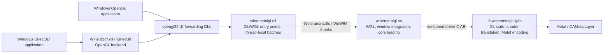

# WineMetalGL Research Notes

Reviewed: 2026-10-17. Repository: [metalsharp/WineMetalGL][repo].
Source snapshot: [`717eb41694c883a1d82f5db9a7b7a1491fa9810b`][snapshot]
(2026-10-16). Latest published release checked: [3.2.0][release-320]
(2026-10-14). The default branch contains work beyond that release; its
features and test results must not all be attributed to the release package.

This is source and published-evidence research. No WineMetalGL build, game,
CTS run, or performance measurement was performed locally. Recommendations
below are investigation candidates, not dxmt9 implementation decisions.

## Overview

WineMetalGL implements OpenGL directly on Metal for Windows applications
running under Wine. Its native core does not depend on Apple's OpenGL or a
Vulkan backend. It is relevant to dxmt9 as another Wine/Metal bridge and as a
possible comparison backend beneath Wine's wined3d OpenGL renderer.

| Property | Finding at the reviewed snapshot |
|---|---|
| API surface | OpenGL 4.6 core and compatibility profiles; OpenGL ES 2.0–3.2 contexts |
| Legacy GL | Fixed-function shaders, immediate mode, display lists, legacy GLSL and ARB programs; compatibility gaps remain |
| Platform | macOS 15+, Apple Silicon; supported Wine module targets x86_64 Wine 11.x under Rosetta |
| Guest architectures | x86_64 and i386 in a WoW64 prefix |
| Native arm64 | Core and native tests build for arm64; an arm64 core package does not establish arm64 Wine module support |
| Build | CMake 3.24+, Ninja, C++20, Objective-C++; llvm-mingw and Wine headers for the PE/unix module |
| Compiler dependencies | Vendored glslang and SPIRV-Cross, with local patches documented in `DEPENDENCIES.md` |
| License | LGPL-3.0-or-later; two Wine-derived WGL files are LGPL-2.1-or-later |

Sources: [README][readme], [building guide][building], [CMake configuration][cmake],
[dependency inventory][dependencies].

## Runtime Architecture

The three implementation binaries plus the forwarding `opengl32.dll` are
distinct deployment artifacts. Since 3.0.0, the module installs without
patching or rebuilding Wine. Older 2.x releases used patched Wine modules;
their installation instructions and test provenance are not interchangeable
with the 3.x module. The unix module loads the core beside itself, through
`include/winemetalgl/driver.h`; `wmgl_initialize` checks
`WMGL_DRIVER_ABI_VERSION` (1 at this snapshot). [Building][building],
[driver ABI][driver-abi], [core initialization][driver].

Window integration has two paths in `src/wine/unix/unix_window.m`:
`winemac_functions` locates an exported `macdrv_functions` table when
available; otherwise WineMetalGL attaches its own view and Metal layer to
the matching Wine Cocoa window. This is useful comparative evidence for
WineHQ support, but does not establish that dxmt9 can drop its existing
symbol-exposing `winemac.so` runtime requirement. [Window implementation][window],
[dxmt9 runtime rules](../../agents/rules/test_wild.rules.md).

### PE/Unix Batching

`tools/gen/wine_gen.py` generates GL entry points and dispatch structures.
Its `batch_kind` policy and `src/wine/pe/winemetalgl.c` implement:

- A lazily allocated, thread-local 16 KiB batch (`BATCH_BYTES`), with
  eight-byte-aligned records containing an operation code and record size.
- Batching for eligible void calls with value arguments, pointer-recording
  vertex-array setters, and selected uniform arrays whose data is copied.
- Exclusion of draw, multi-draw, dispatch, array-element, flush/finish and
  manually handled calls. Draws remain immediate unix calls because they
  can consume client arrays.
- Ordered flushing before an unbatched call, when capacity is exhausted,
  and during thread teardown. Registering a GL debug callback disables
  batching so synchronous callback delivery can occur during the call.
- Separate native and WoW64 dispatch tables, selected by
  `wmgl_unix_batch` / `wmgl_unix_batch_wow64`.

The records are **not pointer-free**: copied uniform payloads are addressed
by pointers rewritten into the batch, and vertex-array setters retain client
pointer values for later draws. `run_batch` checks record boundaries and
operation ranges, but this is a same-process calling convention, not dxmt9's
portable, pointer-free chunk schema. The transferable idea is an explicit
batch eligibility and flush policy; its wire layout must not replace dxmt9's
contract. [Generator][wine-gen], [PE batching][pe], [unix replay][unix-main].

## Shader and Metal Implementation

| Area | Observed design and useful source symbols |
|---|---|
| Programmable shaders | GLSL → glslang SPIR-V → SPIRV-Cross MSL. `shader::compile` / `shader::link` handle compilation and linking; GL interface reflection supplies uniform and resource layouts. |
| Legacy shaders | Fixed-function state selects generated shaders in `src/core/compat/fixed_function.mm`; ARB programs translate to GLSL through `src/core/compat/arb_program.cpp`. |
| GL SPIR-V input | `glSpecializeShader` translates input SPIR-V back to GLSL, then uses the existing compiler/emulation path. This is distinct from the internally generated SPIR-V path. |
| Unsupported Metal stages | Geometry shaders use compute emulation. Tessellation uses control kernels, a CPU reference tessellator, and evaluation vertex functions. Shader fp64 uses software arithmetic. |
| Pipeline caching | `PipelineCache::render`, `depthStencil`, and `sampler` cache Metal state. `prewarmFunctions` compiles default functions asynchronously after link; state-dependent variants still compile on demand. |
| Command encoding | Each context owns a `CommandStream`; render passes start lazily and eligible clears become load actions. A share group owns a Metal `Queue`. |
| Completion and reuse | `Queue` tracks reserved and in-flight serials separately because contexts can submit out of serial order. `TransientAllocator` recycles chunks after their last-use serial completes. |
| Objective-C lifetime | `CallPool` scopes autorelease pools around core entry points; 3.2.0 identifies this as the fix for SOMA memory growth. |

Sources: [compiler interface][compiler], [GL 4 architecture decisions][decisions],
[function prewarming][program], [pipeline cache][pipeline],
[command stream][command-stream], [queue][queue], [transient allocator][transient],
[context and CallPool][context], [3.2.0 release][release-320].

Two performance/correctness interactions deserve focused follow-up:

1. **Texture compression and feedback.** Texture storage normally avoids
   `MTLTextureUsagePixelFormatView` unless needed. However,
   `DrawState::uncompressFeedbackTextures` detects overlapping sampled and
   attached texture storage and enables format-view storage for that case.
   Release 3.2.0 explicitly repairs feedback reads regressed in 3.1.0.
   A compression optimization therefore needs aliasing, mip-level and
   read-after-write evidence, not just faster render-target timing.
   [Texture storage][texture-storage], [draw implementation][draw].
2. **Shader-write ordering.** `CommandStream::waitForShaderWrites` and
   `memoryBarrier` distinguish encoder transitions and the kind of pending
   consumer. These are useful cases for dxmt9 barrier tests; they do not
   prove equivalent ordering for D3D9 or justify removing its synchronization.
   [Command-stream implementation][command-stream-impl].

## Published Evidence and Its Limits

### Conformance

The checked-in GL 4.6 baseline files record commit `49c5099`, with native
configuration 1 and Wine configurations 1 and 3. Each raw result contains
15,156 `Pass`, 3 `Fail`, 1 `CompatibilityWarning`, and 4,554 `NotSupported`
cases, totaling 19,714. The native result's failures are:

- `KHR-GL46.clear_tex_image.negative_gl_clear_tex_and_sub_image_compressed_texture`
- `KHR-GL46.internalformat.renderbuffer.rgb9_e5`
- `KHR-GL46.texture_view.view_sampling`

The warning is
`KHR-GL46.direct_state_access.framebuffers_check_status`.
The generated conformance table shows 15,157 passes, whereas the raw file
keeps the compatibility warning separate. Preserve that distinction when
quoting the reported 99.98%: it excludes `NotSupported` cases and is not a
claim that all 19,714 cases pass. These published CTS runs also do not establish
Khronos certification or a fresh full-suite result for the reviewed HEAD.
[Raw baseline][cts-baseline], [conformance report][conformance].

Upstream documentation has stale passages. `docs/unsupported.md` still says
contexts stop at GL 4.3, while `src/core/driver.mm` sets `kHonestMajor = 4`
and `kHonestMinor = 6`, consistent with the README and 3.x releases. Use the
source snapshot and dated results to resolve that conflict. [Unsupported][unsupported],
[version selection][driver].

### Wine and Direct3D

The current testing guide reports the following Wine 11.0 results on an
Apple M4, separately for both x86_64 and i386 guests:

| Suite | Checks per architecture | Failures | Skipped |
|---|---:|---:|---:|
| `d3d11` | 561,394 | 230 | 9 |
| `d3d10core` | 194,651 | 209 | 0 |

Upstream attributes 205 failures in each suite to D24 depth-bias behavior
when storage uses `Depth32Float`, and lists other viewport, sampling and
shader failures. These are wined3d-on-WineMetalGL results, not a direct
D3D-to-Metal implementation. The inspected testing guide supplies no D3D9
conformance result; D3D9 compatibility and performance require their own
qualified lane. [Testing guide][testing].

### Performance

Release 3.1.0 reports a stock Wine 11.0 void GL call dropping from
854/906 ns to 75/81 ns for 64/32-bit guests, and DOOM (2016) moving from
20–25 FPS to 60 FPS on an M4. These are upstream measurements, with the
game described as measured during play; they are not dxmt9 benchmarks.
[3.1.0 release][release-310].

The checked-in performance page is older evidence at `49c5099` (2026-10-12):
three runs of 600 frames after warm-up, vsync off, mostly small demos and one
trace. It includes three failing budget rows (`scene33-trace`,
`scene4x-core42`, `scene4x-core43`). Do not combine those results with the
3.1.0 improvements into an implied current, uniformly passing benchmark.
[Performance report][performance].

## Relevance to dxmt9

| Candidate | What to investigate | Required distinction or evidence |
|---|---|---|
| Bridge overhead | Eligibility rules, uniform payload copying, explicit flush boundaries | dxmt9 batches D3D9 draw/state records and requires pointer-free POD; WineMetalGL still bridges draws individually |
| Metal state reuse | Sampler/PSO cache keys and prewarming default functions | Measure cold compilation and warm CPU cost separately; preserve D3D9 variant semantics |
| Render-pass continuity | Lazy encoder opening, clear folding, barrier-triggered pass endings | Follow dxmt9's refinement/model/GPU-oracle requirements before changing stateful behavior |
| Storage and lifetime | Completion-qualified transient reuse, autorelease scope, compression/feedback interaction | WineMetalGL's per-serial completion sets differ from dxmt9's completion waterline |
| Compatibility cases | Depth-bias precision, client arrays, aliasing, uniform layout, callback ordering | Translate observations into independent D3D9 cases; GL success does not prove D3D9 correctness |
| Comparison runtime | Wine builtin D3D9 → wined3d OpenGL → WineMetalGL | Verify the selected renderer, Wine/module architecture, shaders, images and frame pacing in an isolated experiment |

WineMetalGL is most useful here as a source of concrete test cases and
architecture comparisons. It adds another full API translation layer below
wined3d, whereas dxmt9 translates D3D9 directly into Metal. No relative
performance or compatibility ranking follows from that structural difference.

### License Boundary

The current project is LGPL-3.0-or-later. The README states that releases
through 2.1.0 were MIT, but that historical statement does not license the
reviewed HEAD under MIT. Wine-derived `wgl_formats.c` and `wgl_fonts.c` are
LGPL-2.1-or-later; vendored dependencies retain their own licenses.

Under dxmt9's [reference policy](../../agents/rules/codebase_conventions.rules.md#license-and-reference-policy),
use this snapshot for architectural and behavioral study. Do not import its
LGPL implementation into dxmt9's MIT-compatible code. Any proposed reuse
from an older revision or a vendored component needs exact file/revision
license provenance. [Upstream license statement][readme].

## Related dxmt9 Research

- [Wine D3D9](wine-d3d9.md): wined3d architecture and submission behavior.
- [wined3d OpenGL shader translation](shader-translation-wined3d-opengl.md):
  the shader frontend above a possible WineMetalGL backend.
- [DXMT](dxmt.md): direct D3D10/11-to-Metal comparison.
- [Metal render-pass lifecycle](metal-render-pass-lifecycle.md): encoding
  ownership and pass-continuation distinctions.
- [Rendering correctness rules](../../agents/rules/rendering_correctness.rules.md):
  evidence required before adopting stateful rendering optimizations.

[repo]: https://github.com/metalsharp/WineMetalGL
[snapshot]: https://github.com/metalsharp/WineMetalGL/tree/717eb41694c883a1d82f5db9a7b7a1491fa9810b
[release-320]: https://github.com/metalsharp/WineMetalGL/releases/tag/winemetalgl-3.2.0
[release-310]: https://github.com/metalsharp/WineMetalGL/releases/tag/winemetalgl-3.1.0
[readme]: https://github.com/metalsharp/WineMetalGL/blob/717eb41694c883a1d82f5db9a7b7a1491fa9810b/README.md
[building]: https://github.com/metalsharp/WineMetalGL/blob/717eb41694c883a1d82f5db9a7b7a1491fa9810b/docs/building.md
[cmake]: https://github.com/metalsharp/WineMetalGL/blob/717eb41694c883a1d82f5db9a7b7a1491fa9810b/CMakeLists.txt
[dependencies]: https://github.com/metalsharp/WineMetalGL/blob/717eb41694c883a1d82f5db9a7b7a1491fa9810b/DEPENDENCIES.md
[driver-abi]: https://github.com/metalsharp/WineMetalGL/blob/717eb41694c883a1d82f5db9a7b7a1491fa9810b/include/winemetalgl/driver.h
[driver]: https://github.com/metalsharp/WineMetalGL/blob/717eb41694c883a1d82f5db9a7b7a1491fa9810b/src/core/driver.mm
[window]: https://github.com/metalsharp/WineMetalGL/blob/717eb41694c883a1d82f5db9a7b7a1491fa9810b/src/wine/unix/unix_window.m
[wine-gen]: https://github.com/metalsharp/WineMetalGL/blob/717eb41694c883a1d82f5db9a7b7a1491fa9810b/tools/gen/wine_gen.py
[pe]: https://github.com/metalsharp/WineMetalGL/blob/717eb41694c883a1d82f5db9a7b7a1491fa9810b/src/wine/pe/winemetalgl.c
[unix-main]: https://github.com/metalsharp/WineMetalGL/blob/717eb41694c883a1d82f5db9a7b7a1491fa9810b/src/wine/unix/unix_main.c
[compiler]: https://github.com/metalsharp/WineMetalGL/blob/717eb41694c883a1d82f5db9a7b7a1491fa9810b/src/core/shader/compiler.h
[decisions]: https://github.com/metalsharp/WineMetalGL/blob/717eb41694c883a1d82f5db9a7b7a1491fa9810b/docs/decisions/0002-gl4-architecture.md
[program]: https://github.com/metalsharp/WineMetalGL/blob/717eb41694c883a1d82f5db9a7b7a1491fa9810b/src/core/program.mm
[pipeline]: https://github.com/metalsharp/WineMetalGL/blob/717eb41694c883a1d82f5db9a7b7a1491fa9810b/src/core/metal/pipeline_cache.mm
[command-stream]: https://github.com/metalsharp/WineMetalGL/blob/717eb41694c883a1d82f5db9a7b7a1491fa9810b/src/core/metal/command_stream.h
[command-stream-impl]: https://github.com/metalsharp/WineMetalGL/blob/717eb41694c883a1d82f5db9a7b7a1491fa9810b/src/core/metal/command_stream.mm
[queue]: https://github.com/metalsharp/WineMetalGL/blob/717eb41694c883a1d82f5db9a7b7a1491fa9810b/src/core/metal/queue.h
[transient]: https://github.com/metalsharp/WineMetalGL/blob/717eb41694c883a1d82f5db9a7b7a1491fa9810b/src/core/metal/transient.h
[context]: https://github.com/metalsharp/WineMetalGL/blob/717eb41694c883a1d82f5db9a7b7a1491fa9810b/src/core/context.h
[texture-storage]: https://github.com/metalsharp/WineMetalGL/blob/717eb41694c883a1d82f5db9a7b7a1491fa9810b/src/core/texture_storage.mm
[draw]: https://github.com/metalsharp/WineMetalGL/blob/717eb41694c883a1d82f5db9a7b7a1491fa9810b/src/core/draw.mm
[cts-baseline]: https://github.com/metalsharp/WineMetalGL/blob/717eb41694c883a1d82f5db9a7b7a1491fa9810b/tests/cts/baseline/gl46-cfg1-native.txt
[conformance]: https://github.com/metalsharp/WineMetalGL/blob/717eb41694c883a1d82f5db9a7b7a1491fa9810b/docs/conformance.md
[unsupported]: https://github.com/metalsharp/WineMetalGL/blob/717eb41694c883a1d82f5db9a7b7a1491fa9810b/docs/unsupported.md
[testing]: https://github.com/metalsharp/WineMetalGL/blob/717eb41694c883a1d82f5db9a7b7a1491fa9810b/docs/testing.md
[performance]: https://github.com/metalsharp/WineMetalGL/blob/717eb41694c883a1d82f5db9a7b7a1491fa9810b/docs/performance.md
