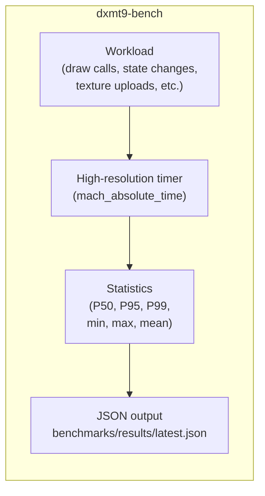

# Benchmarks Spec

---

## 1. Harness Structure

The benchmark harness is a single native macOS executable `dxmt9-bench` that
drives the `BackendDevice` interface directly. No Wine, no D3D9 COM.



Each workload runs for a fixed number of iterations (warm-up + measured),
discards the warm-up results, and reports statistics over the measured window.

---

## 2. Timing

All timing uses `mach_absolute_time()` converted via `mach_timebase_info` to
nanoseconds. Wall-clock time, not CPU time — measures end-to-end latency
including GPU scheduling.

For GPU-bound workloads, timing includes a `flush()` + GPU wait to ensure the
GPU has completed before the timer stops.

For CPU-bound workloads (draw call throughput), the GPU is intentionally
kept behind; only CPU submission time is measured.

```
warm-up: 1000 iterations (discarded)
measured: 5000 iterations
report: P50, P95, P99, min, max, mean of per-iteration time
```

---

## 3. Draw Call Throughput Workload

```
for each iteration:
  begin_frame()
  for each run in grouped_draw_runs:
    submitDrawRun(run)    ; flat state + per-draw params vary by sub-workload
  flush()                 ; submit without GPU wait
  end_frame()
timer measures: time from begin_frame to flush()
```

Three sub-workloads:
- **Identical state**: all `desc[i]` identical. Measures minimum per-draw overhead.
- **State change**: `desc[i]` alternates between two different render states.
  Forces PSO cache lookup on every draw.
- **Unique shader**: `desc[i]` uses a different pre-compiled shader each time.
  Exercises the shader variant dispatch path.

---

## 4. PSO Compile Workload

**Cold (empty cache):**
1. Delete `~/Library/Caches/dxmt9/` before run
2. Submit a draw that requires a new PSO
3. Wait for PSO future to resolve
4. Measure total time from draw submission to PSO ready

**Warm (disk cache populated):**
1. Run cold workload once to populate `MTLBinaryArchive`
2. Restart harness (new process, empty in-memory cache)
3. Repeat same draw submission
4. Measure time to PSO ready — should hit `MTLBinaryArchive`

---

## 5. Comparison Script

`scripts/bench_compare.sh` takes two JSON files and produces a report:

```
Workload                          dxmt9       wined3d     ratio
─────────────────────────────────────────────────────────────────
draw_throughput_identical         1,850K/s    420K/s      4.4×
draw_throughput_state_change        920K/s    210K/s      4.4×
pso_cold_first_frame                340ms     890ms       2.6×
pso_warm_first_frame                 12ms      45ms       3.8×
frame_time_simple_p50               2.1ms      8.4ms      4.0×
frame_time_simple_p99               3.8ms     24.1ms      6.3×
```

A regression marker `↓` is shown if dxmt9 result is >5% worse than its own
stored baseline.

---

## 6. File Layout

```
benchmarks/
├── baselines/
│   ├── dxmt9.json          dxmt9 stored baseline (committed)
│   ├── wined3d.json        wined3d reference (committed)
│   └── d9vk_mvk.json       D9VK+MoltenVK D3D9 reference (committed)
└── results/                Run output (gitignored)
    └── .gitkeep
scripts/
└── bench_compare.sh        Regression comparison + report
tests/
└── bench.cpp               dxmt9-bench source
```

## 7. Actual PE Constant-Setter Economy

R-BENCH-6.1–6.4 define a separate Wine/PE lane. The PE executable owns only
public COM calls, prebuilt value arrays and Windows timing APIs; no Darwin or
Metal API crosses into PE. Reuse the existing conformance executable's device
setup/teardown and add a test-only `setter-economy` selector with a separate
translation unit. The default pixel, StateBlock, capture and lifecycle
selectors remain unchanged. An economy run explicitly reports no pixel oracle.

The bounded matrix uses all six VS/PS float/int/bool families, counts 1/3/4,
equal/last-only/all-changed shapes, an additional count-three middle-only
shape, and count-zero controls: 66 cells. Use 50 million measured calls and
10,000 warm-up calls per cell. Inputs alternate two prebuilt arrays; equality
uses identical bytes at distinct addresses, while changed cells start with
the B state and alternate A/B. Materialize a six-register neighborhood before
timing so growth is excluded and exact getters can pin surrounding values.
Independent pre-call snapshots of both caller arrays qualify source immutability;
the getter oracle must not use caller memory that a broken setter could mutate.
No Draw, Present, flush or resource mutation belongs inside a measured cell.

Select the COM family outside the measured loop. Accumulate all HRESULTs;
read QPC and process user/kernel time only around the complete loop.
Emit one structured cell receipt with raw timing values, denominators and
state checks, `cpu_scope=process`, process/calling-thread identity, plus an
exact cell-count footer. A strict host parser checks
the complete matrix, identities and footer before producing per-call values.
Zero-count controls are reported separately, never subtracted automatically.

Run fresh processes with detailed recorder/range/stopped-PC observers disabled,
using the canonical conformance runner and actual Wine staging receipts.
Strip ambient Wine/DYLD overrides as well as renderer/Metal observers; record
the effective environment digest passed to the canonical runner, its source
hash and manifest hash, and the actual Wine Unix runtime image hashes. These
receipts qualify the controlled fixture, not the entire host scheduling state.
Repeated baseline/candidate processes must load the intended PE image. Timing
includes public setter validation, the loop and warmed PendingDelta work, but
does not cover later owner emission, dirty consumption, allocation, StateBlock
recording or whole-frame scheduling. Timer resolution, warm-state bias and
Wine translation and helper-thread CPU remain explicit limitations. Neither a local win nor a native
helper microbenchmark alone promotes a renderer performance lane.

The fixed call count must be calibrated against the actual Wine timer: initial
one-million-call cells can be shorter than a CPU-time quantum, even when QPC
is nonzero. Such pilot results do not qualify CPU economy. Fifty million calls
lengthen this bounded workload without introducing clocks in the loop; raw
CPU quantization and remaining measurement resolution must still be reported.
Use explicit `GetProcessTimes`, not an assumed thread-local
`GetThreadTimes(GetCurrentThread())`: the audited Sikarugir Darwin implementation
falls back to process `times()`. The CPU metric includes any fixture/Wine/provider
helper threads; calling-thread identity identifies the setter source, not
exclusive CPU attribution. Native Darwin thread observation is a separate lane.

## 8. Actual PE Draw-Parent Economy

R-BENCH-7.1–7.4 add a standalone on-demand PE fixture,
`tests/conformance/d3d9/d3d9_draw_parent_economy.cpp`. The public COM device
owns a hardware-only 32×32 FFP offscreen target, managed VB/IB, event query
and readback surface. It calls no Darwin or Metal API. The host driver
`scripts/tools/run_pe_draw_parent_economy.py` owns canonical Wine staging,
environment isolation and provenance; `summarize_pe_draw_parent_economy.py`
owns fail-closed transcript qualification.
The conformance manifest marks this auxiliary `on_demand = true`: ordinary
suite runs omit it, while an explicit `--aux-exe` selection enables it. The
dedicated driver always makes that selection, preventing a long timing matrix
from silently joining routine conformance runs.

The matrix has nine cases (`steady`, `viewport`, `viewport_scissor`, `scalar`,
`stream_offset`, `six_constants`, `vs_f3_equal`, `vs_f3_changed`,
`vs_f4_changed`) and three paths (`setters_only`, `primitive`, `indexed`):
27 cells. Each group contains 32 iterations. Default timing uses 512 measured
groups after eight warm groups, with test-only bounded overrides. Prebuilt
alternating inputs avoid timed allocation; equal inputs have distinct source
addresses. Exact getters check constant extents and surrounding registers.
The six-family case changes one register per family; VS-F cases exercise
three/four-register calls. These are fixture shapes, not a current workload
population distribution.

Each group establishes base state and executes Clear/BeginScene/seed draw
before QPC. Draw paths clear the target again before QPC so the seed cannot
make a dropped measured draw pass the pixel oracle. Only setter calls and
the selected draw belong inside QPC.
EndScene, event issue/drain and final getters/readback are outside. Process
CPU reads bracket the complete row and are explicitly broader than the sum
of QPC intervals. Raw ticks remain authoritative; rounded nanoseconds,
zero-setter controls and timer cost must not become invented exclusive costs.

A short separate trace uses the same group shape with recorder chunk logging.
All fixture-owned records use flushed stderr, the recorder logger's stream;
the canonical runner's separate stdout/stderr capture must not reorder markers
and chunk events into a false temporal proof.
`begin → timed_begin → timed_end → end` markers must be complete, ordered and
identity-qualified by case/path/group; a recorder flush inside a timed pair
rejects qualification. A trace proves only its observed run, not the absence
of all scheduler interference in an observer-disabled run. The driver must
preserve both kinds of evidence without treating traced values as economics.

Structured `draw_parent_*` schema-1 receipts include exact row closure,
raw QPC/process CPU values, PID/TID, both public vtable RVAs, HRESULT totals,
getter/input checks, two pixel values and successful final teardown. The
native script test `dxmt9-summarize-pe-draw-parent-economy` pins malformed,
stale/mismatched and missing evidence rejection before any Wine measurement.
The driver records source/build-option and five-runtime-image identities,
fixture/tool/manifest hashes, effective runner environment digest and actual
Wine runtime hashes. Output directories are new and immutable per invocation;
shared Wine-root destinations are checked during that invocation, not later
when they may have been restaged by another process.

The scope remains warmed FFP with one stream and one triangle, without Present,
programmable shaders, UP, StateBlock or allocation-failure paths. Pixel checks
qualify VB/IB geometry and these selected states; constants are qualified by
getters, not shader consumption. The existing programmable pixel/refinement
lanes and wild CPU/FPS checks remain separate acceptance layers.
The setter-only pixel is intentionally the seed draw; changed setter state
is qualified by getters, not subsequent visual consumption.
