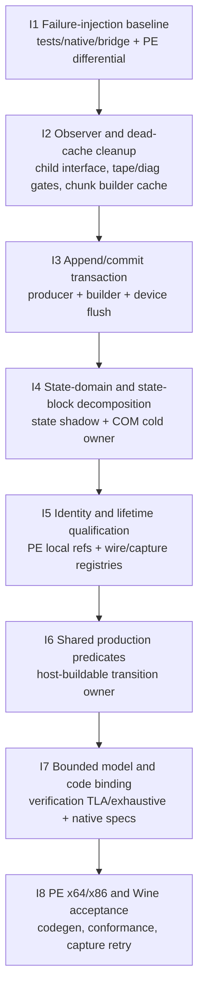

# PE Recorder Spec

Companion to [requirements.md](requirements.md). This document owns the target
design; [gap.md](gap.md) records where the current implementation or evidence
does not yet satisfy it.

## 1. Ownership and boundaries

| Concern | Exact owner | Must not own |
|---|---|---|
| COM validation, app-visible state, getters | `D3D9DeviceImpl` in `src/d3d9/d3d9_pe_device_impl.hpp` and its cold COM TUs | Metal objects, unix queue state |
| State-domain value types and typed keys | `src/d3d9/d3d9_pe_state_shadow.hpp`, `d3d9_pe_const_shadow.hpp` | COM lifetime, capture journaling |
| Sparse normalization | a recorder-capability-bound compact shadow plan or bounded `SparseStateInput` feeds one prepared section/identity witness; `PeSemanticBatchOwner` owns canonical payload and qualified pins | a second production builder, retention or pending consumption during pure preparation |
| Record/chunk transaction | mandatory `PeProductionSemanticRecorderState` / `PeSemanticBatchOwner` and `D3D9DeviceImpl::appendRecord` / `flushPendingCommandChunk`; `CommandChunkBuilder` is limited to tests and Render Tape bootstrap construction | D3D9 getter authority, Metal execution |
| PE local pinning | the semantic owner's kind-qualified pin arenas and bounded retainer own physical retain/rollback | Render Tape logical settlement |
| Wire registry resolution | `WireObjectRegistry` in `src/d3d9/device_c_chunk_registry.*` | PE wrapper-pointer identity |
| Capture registry and settlement | Nullable heap-owned `PeCaptureState` in `src/d3d9/d3d9_pe_capture_state.hpp`, operated by `D3D9DeviceImpl` cold methods in `d3d9_pe_device_tape.cpp` | changes to app HRESULT or capture-off cadence |
| PE recorder diagnostics | Optional `PeDiagnosticsState` in `src/d3d9/d3d9_pe_diagnostics_state.hpp`, operated by cold helpers in `d3d9_pe_device_diag.cpp` and nullable hot gates | recorder protocol counters, pacing limits, semantic shadows, capture transaction state |
| State-block wrapper snapshot | `D3D9StateBlockImpl` in `d3d9_pe_device_child_misc.cpp` and `D3D9StateBlockShadow` in `d3d9_pe_stateblock_shadow.hpp` | expanding the tracked set during Capture |
| Import, replay, execution | unix importer and `CommandQueue` | reading PE `LiveShadow` or COM pointers |

`D3D9DeviceImpl::QueryInterface` remains declaration-only in
`src/d3d9/d3d9_pe_device_impl.hpp`, with its unchanged body out-of-line in
`src/d3d9/d3d9_pe_device.cpp`. It is the first declared non-pure, non-inline
virtual and deliberately anchors the vtable and inline virtual bodies in the
owning TU. `FlushPeRecorderForChild` is a private nonvirtual helper. Cold-
interface cleanup must preserve the QueryInterface placement unless codegen
measurement authorizes a different one.

## 2. State model

For a category `c` and qualified key `k`, recorder state is:

```text
S = <LiveShadow, PendingDelta, StateBlockRecorded, Builder, CaptureLedger>
LiveShadow[c, k]          = current D3D9-visible value
PendingDelta[c, k]        = newest value not represented by an accepted record
StateBlockRecorded[c, k]  = value in the fixed tracked set of a state block
```

`LiveShadow` is total over supported getter-visible state after defaults are
established. `PendingDelta` and `StateBlockRecorded` are partial maps. Typed
keys prevent accidental equality across domains such as render-state slot 7
and sampler slot 7. Their factories return a one-word bounded value or an
invalid sentinel; recorder boundaries reject the sentinel before mutation or
retain. `PeHotStateShadow::Transition`, private `Maintenance`, `Snapshot`, and
`Consumer` separate atomic live-plus-pending mutation, bounded maintenance,
read-only observation, and exact pending settlement. “Snapshot” is
a capability boundary, not global object immutability: the owning recorder may
continue mutation through its writer while readers cannot obtain mutable table
or category access. The StateBlock transaction exposes phase-checked
`withRecordingWriter` callbacks and
`recordedSnapshot()`; wrapper snapshots use their own writer/snapshot views.
Flat storage and raw category enumeration remain implementation details.

### 2.1 Category table

| Category | Qualified key / value | `LiveShadow` owner | `PendingDelta` form | `StateBlockRecorded` policy | Wire/cold disposition |
|---|---|---|---|---|---|
| Render state | `RenderStateSlot -> u32` | `renderStateShadow` | `pendingRenderStates` | last explicit write per touched key; recording does not mutate primary state | render-state sparse section |
| Texture-stage state | `(TextureStageIndex, TextureStageStateType) -> u32` | `tssShadow` | `pendingTss` | last write per touched pair | TSS sparse section |
| Sampler state | `(SamplerIndex, SamplerStateType) -> u32` | `samplerStateShadow` | `pendingSamplerStates` | last write per touched pair | sampler sparse section |
| Texture binding | `(TextureKind, SamplerIndex) -> PeWireObjectRef?` | `textures_` plus binding view | `pendingTextureMask` + live ref | last binding per touched slot | texture handle section |
| Stream source / frequency | `(BufferKind, stream) -> {ref, offset, stride}` plus `(stream) -> frequency` | `streamSrc_`, `streamOff_`, `streamStr_`, `streamFreq_` | source mask and live binding; frequency is an independent tracked table | each explicit setter tracks only its semantic aspect; Apply preserves the unrecorded aspect | stream source section plus explicit frequency |
| Vertex/pixel shader | `(ShaderKind, stage) -> ref?` | `vs_`, `ps_` | `pendingVs`, `pendingPs` | last binding per touched stage | shader handle section |
| Vertex input | `FvfKey` or `(VertexDeclKind, singleton)` | `fvf_`, borrowed `vdecl_` | `pendingFvf`, `pendingVdecl` | declaration touch fixes the tracked singleton; candidate/saved wrapper owns the AddRef through synchronous Apply, and Commit borrows without an extra retain/transfer | vertex-input section |
| Index buffer | `(BufferKind, singleton) -> ref?` | `indexBuf_` | `pendingIb` | last binding | indexed-draw index section only |
| Render targets/depth | `(SurfaceKind, rtSlot)` / `(SurfaceKind, depth)` | `rtSlots_`, `dsSurface_` and explicit masks | `pendingRtMask`, `pendingDs` | last binding per touched slot | attachment sections |
| Viewport/scissor/material | singleton typed value | dedicated PE value | one pending bit each | last touched singleton | scalar sparse section |
| Transform | `TransformState -> D9CMatrix` | `transformShadow` | `pendingTransforms` | `SetTransform` records last value; `MultiplyTransform` is the enumerated prior-value operation and Wine-compatible capture exception | transform sparse section |
| Clip plane | `clipPlane[0..5] -> float4` | `clipPlaneShadow` | pending mask | last value per touched plane | clip-plane section |
| Light / enable | `lightSlot -> D9CLight/bool` | light arrays/mask | separate value and enable masks | last value per touched slot | light and enable sections |
| Shader constants | `(stage, scalarKind, registerRange) -> bytes` | `PeConstShadowBlock` values | dirty ranges | fixed tracked ranges; Capture refreshes values only | standalone or inline constant-range section |
| Ordered commands | command ordinal | not state | not commutative state | not captured as ordinary state unless D3D9 explicitly says so | command record / barrier |

`PeWireObjectRef::object` is a local lifetime aid in the table, never a wire
field. Any PE-local lookup or pending-lifetime query uses the qualified pair
`(identity.kind, object)`; the builder's presence accelerator and its bounded
overflow fallback preserve that qualification. The wire form is always
`(kind, generation, objectId)`.

### 2.2 Algebra

For an ordinary validated setter outside state-block recording:

```text
Set(c, k, v):
  if LiveShadow[c, k] = v and k notin PendingDelta[c]: no-op
  else LiveShadow'[c, k] = v
       PendingDelta'[c, k] = v
```

For the same key, `Set(k, a); Set(k, b)` is observationally equivalent to
`Set(k, b)` at the next record boundary. For independent keys, the final maps
commute and canonical serialization may order by qualified key. These equations
do not permit reordering across a command ordinal, Begin/End, barrier,
resource/alias transition, or prior-value operation.

Preparing a record computes a non-owning candidate projection:

```text
Candidate = Normalize(LiveShadow, PendingDelta, explicit draw/control input)
```

Ordinary draws and APPLY_STATE may prepare a compact, non-movable shadow plan
under a recorder capability. The owner consumes it synchronously; selected
values need not first be copied into `PeSparseScratch`. Bounded sparse views
remain supported for oversized and explicit-input producers through the same
owner, not a compatibility builder. Preparation binds source validity,
destination stream/index selection, section layout, qualified identity order,
and logical quotas. A CapacityPre destination change requalifies destination
facts without consuming the input or pending state. Append writes canonical
values and bindings, acquires qualified pins, and accepts exact PendingDelta
settlement atomically. No plan or derived borrow survives that append or the
recorder guard. `CommandChunkBuilder` remains a native/bootstrap oracle; a
compact source representation is not permission to select it in production.

Only accepted settlement through the consume capability may perform:

```text
PendingDelta' = PendingDelta \ represented(Candidate)
```

Thus an accepted record followed by ordered unix replay reconstructs the same
effective state as `LiveShadow` at that record's ordinal. Failure returns the
pre-attempt state, including dirty constant ranges and oversized-table rows.
Acceptance validates every bounded wire key first, so one malformed row cannot
partially erase an otherwise valid batch.

The effective `FULL_SNAPSHOT` disposition is part of the prepared producer
state and remains attached through emission and settlement. A snapshot
projects clean `LiveShadow` scalar rows without requiring fabricated
`PendingDelta` tokens. Every represented pending row undergoes canonical-order
and exact category/key/index/value validation and is consumed exactly once.
When the default-off cold scalar observer is enabled, that same transition also
checks its setter-source and builder-record ordinals; this conditional witness
does not prove that the default path retains a source ordinal. Rows not
represented by a bounded projection remain pending. If an accepted append
cannot settle, the recorder enters the existing fail-stop state instead of
returning `S_OK` with stale state.

### 2.3 State-block transitions

| Operation | Success transition | Failure transition |
|---|---|---|
| Begin | flush older pending work; create an empty recorded domain; enter Recording | preserve prior domains; do not enter Recording |
| Explicit Set while Recording | validate; last-write-wins in `StateBlockRecorded` only; do not mutate `LiveShadow`, `PendingDelta`, or backend primary state | no new tracked key or value |
| Prior-value operation while Recording | apply to primary live/backend state without enlarging `StateBlockRecorded`; `MultiplyTransform` is the current enumerated case | preserve primary and recorded domains on pre-effect failure |
| End | flush ordering work; freeze the tracked set; create the wrapper-owned snapshot; leave Recording without a restore replay | pre-backend failure preserves Recording; backend failure after entry or wrapper allocation failure after accepted backend End leaves Recording, discards the unpublished PE candidate, and poisons the recorder |
| Capture | refresh values for the existing tracked keys/ranges only | preserve prior captured snapshot |
| Apply | flush and prevalidate the fixed set, apply the backend once, then publish the fixed PE shadow directly without allocation or fallible setters | pre-backend failure preserves PE/backend state; a backend failure latches recorder poison because the unix operation may have partially mutated |

The implemented PE recorder owns one closed `PeStateBlockTransactionState`
whose API advances Recording, inside-End publication, poison/reset, candidate
release, and prepared-Apply transfer as one transaction domain. It contains
one fixed typed `StateBlockRecorded` candidate
covering keyed render/TSS/sampler/transform state, texture, and independently
tracked stream source tuples (buffer/offset/stride) and stream frequencies,
index/VS/PS/FVF/vdecl bindings,
render-target/depth attachments, viewport/scissor/material, clip planes,
lights/enables, and all six shader-constant kinds. Pointer slots are opaque in
the native value owner; the PE device takes and releases their COM references
at candidate replacement, End snapshot, Capture refresh, and Begin/reset
boundaries. Apply staging uses category-qualified texture, stream, shader,
index, render-target, and depth values with private occupancy masks; identical
COM identities in multiple occupied slots retain and settle independently.
A second write to one occupied qualified staging cell is rejected before
AddRef and leaves the first value intact, so the occupancy bit and retained
owner cannot diverge. A successful Begin increments a monotonic recording
epoch. `RecordingCapability` captures that epoch and rechecks both it and the
Recording phase on every scoped writer call; Reset does not rewind the epoch,
and exhaustion poisons instead of wrapping.
`CandidateOwnedVertexDeclaration` is the candidate snapshot's one owned retain
of a vertex declaration. The device's bound `vdecl_` slot is borrowed: binding
and clearing it do not AddRef/Release that slot; an implicit-FVF declaration is
kept alive only by `fvfDeclCache_`, while candidate capture/End ownership is
settled through the transaction visitor. This distinction is pinned by the
native duplicate-retain lifecycle case.
Explicit setters route to this candidate while recording, so
`LiveShadow`, `PendingDelta`, getters, backend state, and capture journaling
remain unchanged. Initial `CreateStateBlock` snapshots establish bounded
tracked sets from the current PE shadows using the typed `ALL`, `VERTEXSTATE`,
or `PIXELSTATE` disposition (including exact render/TSS/sampler key masks);
Begin/End snapshots use `Explicit` and copy only explicitly touched candidate
keys; later Capture refreshes those keys without enlargement. A source-only
record never changes the saved frequency, and a frequency-only record never
changes the saved source tuple.
`MultiplyTransform` uses the prior-value transition, persists primary live
state, and never enlarges the recorded transform set. Consequently the
sequence `SetTransform(B); MultiplyTransform(C)` inside Begin/End records `B`
while the multiply reads the pre-Begin primary value and publishes only its
result to primary state.

`d3d9_pe_stateblock_transition_table.inc` is the canonical serial/reference
matrix for Begin, End, Capture, Apply, Reset, and teardown. Production calls
`planPeStateBlockTransition`; the generator emits
`PeStateBlockTransitionTable.tla`, checks enum/table completeness, and the
bounded model requires each step to match its generated row. The model carries
duplicate-retain cardinality only. Native fake-COM tests separately demonstrate
one retain and one release or transfer per occupied category/slot for repeated
object identities; the model is not a proof of COM implementation behavior.
The same model retains an issued capability across End/Reset and a second
Begin. `StaleCapability` deliberately checks phase without epoch and must
violate `NoStaleCapabilityWrite`; the native witness binds that abstract ABA
trace to the production capability. Concrete same-slot overwrite/AddRef
conservation remains native evidence rather than an abstract COM model.
The same table defines `PoisonRequested` for every non-terminal phase. Its
production effect discards candidate ownership, releases all occupied Apply
staging, preserves capture, and enters or remains in `Poisoned`. There is no
`Terminal` poison row: teardown is absorbing and writes are rejected. The
`PoisonLeak` TLC mutation preserves ownership and must violate
`PoisonOwnsNoCandidateOrRefs`.

The conditional recorder lock is one shared production guard. It covers
Create/Begin/EndStateBlock, Capture, Apply, every PE shadow/recording setter,
and Render Tape child destruction/mutation/ordered-control callbacks that
mutate `PeCaptureState` or its registry when `D3DCREATE_MULTITHREADED` or the
forced-lock setting requires it; the guard is a one-branch no-op on the
ordinary single-threaded hot path. The existing recursive contract permits
bounded internal append/flush re-entry, while callback validation remains
fail-closed and no external callback is invoked under a newly acquired lock.
Default-pool child ownership callbacks use this same guard, so `Reset`'s
legality read is serialized with concurrent resource creation/destruction on a
multithreaded device; the disabled lane keeps the existing plain counter and
only the guard's branch.
Apply preparation reserves live constant capacity and resolves implicit FVF
declarations before backend mutation. A live `SetFVF` resolves and publishes
its cached implicit declaration transaction before changing FVF/declaration
shadows or pending bits; backend null, wrapper null/allocation, and cache
allocation failures release their current owner exactly once and return a
failure HRESULT through the `noexcept` COM boundary. A failed backend Apply
enters explicit recorder poison and subsequent recording writes return `D3DERR_DEVICELOST`
deterministically, avoiding a second divergent stream when rollback is
unavailable. A backend Capture failure uses the same conservative poison
boundary; candidate/snapshot publication still occurs only after Capture
accepts. End backend/wrapper failure uses the same poison boundary because the
unix End owner consumes its recording flag before its remaining fallible work;
the specialized `SetRenderState` entry checks poison before its diagnostic/core
bypass. Poison survives failed Reset/ResetEx, including validation/backend
failure, together with pre-effect Apply staging. A successful backend
Reset/ResetEx clears poison and discards staged Apply retains only after the
backend accepts, restoring the PE recorder for subsequent writes.

## 3. Record and chunk transactions

### 3.1 Append transaction

The builder checkpoints record count, handle count, payload size, and retainer
acquisition before mutation. `PendingDelta` needs an equivalent represented-set
checkpoint even though it is owned outside the builder.

| Outcome | Builder | Retainer | `PendingDelta` | App result |
|---|---|---|---|---|
| pre-capacity flush fails | prior owner transaction remains sealed or unsealed according to its settlement; new record is unattempted | prior pins retained | new prepared token unchanged | failure; no admission call |
| preparation/validation fails | unchanged | unchanged | unchanged | failure |
| payload/pin/arena admission fails | rollback to all owner checkpoints | rollback new pins | unchanged | failure |
| owner record commit fails | rollback active record | rollback new pins | unchanged | failure |
| owner record commit succeeds | record becomes durable in the semantic owner | pins owned by that owner | remove exactly represented entries | success or continue to capacity settlement |
| post-append capacity commit is effect-unknown | sealed accepted record remains owned for Reset/teardown cleanup, not ordinary retry | pins retained | entries remain represented by the accepted record, not reintroduced as a duplicate | failure and recorder poison |

Both sparse-view and compact-plan preparation and every
typed `prepare*Batch` are non-consuming. Their corresponding exact
`acceptPreparedSparseState` / `acceptSparseStatePlan` settlement,
`acceptInlineConstantDelta`, standalone constant flush, and the four oversized
adapters consume only through an Accepted `AppendPlan`; Failed and Discarded
plans retain pending state and the prepared retry witness.

### 3.2 Seal, commit, retry, and capture settlement

| Event | Command disposition | Capture disposition | Lifetime/reset disposition |
|---|---|---|---|
| seal allocation/validation failure | no bridge effect; retry or explicit discard | no event | builder and pins retained |
| repeated seal | byte-identical view of the same builder | no duplicate event | no epoch advance |
| capture preparation rejects before bridge | command may still proceed under normal semantics | abort/reject diagnostic | capture must not alter chunk boundary or HRESULT |
| commit call not entered because a local pre-effect gate fails | no unix effect; exact sealed projection retryable | no materialization | builder and pending refs retained; no reset |
| entered bridge commit fails with no ABI disposition | effect unknown; fail-stop, never ordinary retry | abort current capture attempt; no capture publication | sealed builder and refs retained until successful Reset/teardown discard |
| bridge commit succeeds, capture off | accepted | no work beyond one disabled branch | drain logical refs without capture events as applicable; reset; warm epoch advances |
| bridge commit succeeds, capture active | accepted | materialize referenced objects and append exact command event first | drain pending refs; emit each admitted alias-before-parent destroy once; reset; warm epoch advances |
| explicit discard / poisoned Reset / teardown | never submitted | no command-dependent destroy | drain logical pending refs; release all current and warm pins; clear builder |
| healthy Reset/ResetEx | queued chunk is submitted at the ordering boundary before backend reset | settle as an ordinary accepted command | backend reset then clears PE state; a failed flush preserves the queue and does not enter reset teardown |

The production source of truth for this settlement is the fixed-size
`settleRecorderCommit` algebra in
`src/d3d9/d3d9_pe_commit_transition.hpp`. `flushPendingCommandChunk` binds
each seal, bridge, capture, drain, builder-reset, and warm-retainer transition
to that algebra while retaining the existing successful command cadence.
The current PE/unix ABI returns one HRESULT and cannot distinguish a
pre-effect rejection from a failure after publication or replay. Production
therefore maps every failed entered bridge call to the conservative
effect-unknown/fail-stop disposition. The sealed byte/count/handle/pin
projection remains intact only for Reset/teardown cleanup, not for ordinary
retry. Capture materialization rejection settles only the capture disposition
after an accepted command; it never retracts the command or resets the builder.
Pending Render Tape aliases are retired before their
parent, each ObjectDestroy is admitted once, and reset/warm-epoch advancement
occurs only after all pending references are drained. Explicit discard,
poisoned device reset, and teardown clear the logical builder and retained pins
without command-dependent destroy events or a warm-epoch advance. A healthy
device reset uses ordinary submit first, so queued observable work is not
silently dropped before the backend reset; only after that flush succeeds does
the existing reset-state teardown run.

### 3.3 Public failure containment

PE wrapper factories use non-throwing allocation plus constructor-exception
containment, clear caller outputs before creation, and release a backend handle
when wrapper publication fails. The device takes its factory reference only
after fallible construction work, and device/factory logging swallows its own
diagnostic allocation failures. Cache insertion catches allocation separately
so a recoverable failure maps to `E_OUTOFMEMORY` with both the cache and caller
retains balanced. Provider replay owns retained wrappers through an RAII guard;
presence-accelerator allocation failure selects the complete linear truth
source instead of escaping the C boundary. The unix
offload queue reports `RejectedPreEffect`, `Accepted`, or `EffectUnknown`:
`queuedBytes` and the ledger watermark publish only after deque adoption, and
effect-unknown ownership is drained by the fail-stop queue rather than released
again by the producer. Worker ownership is installed only after thread startup.
Deterministic native injection covers allocation before/after adoption and
thread-start rollback; the recorder settlement matrix separately covers bridge
pre-effect and entered-call effect-unknown behavior.

`RecorderSettlementProjection` is the bounded composition witness. It carries
one category/key/value/ordinal pending token, the concrete builder's active
record ordinal plus record/handle/payload counts, and the seal/bridge/capture/
drain/reset phase. `appendRecord`, `CommandChunkBuilder`, and
`flushPendingCommandChunk` use the same pure dispositions at their existing
branches; no new allocation, virtual call, wire field, or Metal owner is added.
Exact sealed bytes remain a native equality witness. The finite projection is
not a proof of vector layout, allocator behavior, C++ object representation,
or the cross-process ABI.

For one builder, `pendingChunkRefs` is boolean-shaped: a logical identity owns
zero or one pending reference regardless of wrapper release/reacquire churn.
Last-wrapper release transfers to this pending reference while the builder names
the identity. A successful commit settles command capture before the reference;
a failed commit preserves both. Texture-derived aliases remain generation
qualified until parent settlement. A pending alias may force one flush and one
lookup restart before replacement; exhaustion rejects capture without changing
capture-off behavior.

The physical and logical halves are coupled by
`CommittedPendingChunkLease`, a non-copyable, callback-scoped capability issued
only by `CommandChunkBuilder`. The builder proves the complete
`(kind,generation,objectId)` wire identity and the expected local wrapper
pointer against a handle below the active-record checkpoint. An active-only
handle, or a warm retainer pin with no current committed handle, cannot issue a
lease; rollback therefore cannot leave a stale logical witness. The capability
does not own a retain or release: the builder retains and rolls back physical
pins, while the nullable Render Tape registry consumes the witness to transfer
`pendingChunkRefs`. Drain enumerates typed committed witnesses, visits duplicate
handles when present, and relies on the boolean-shaped logical ref as the
exactly-once guard. Alias witnesses are drained before parent witnesses,
independent of wire handle order. Capture-off adds no sidecar/vector or
per-command bookkeeping.

## 4. Identity and callback contracts

Two different relations are intentional:

```text
LocalIdentity = <kind, wrapperPointer>
WireIdentity  = <kind, generation, objectId>
```

Local dedup may compare both relations to detect an impossible identity/pointer
collision. Wire import first validates the complete handle array, then resolves
and retains in entry order. The current `WireObjectRegistry::resolveAndRetain`
holds its mutex while invoking the retain callback; this is safe only while the
callback is `noexcept`, direct AddRef/pin work, and non-reentrant. That premise
must be a predicate and a negative-control test, not an informal assumption.

The PE `g_wireObjectCache` was written by publication and destruction paths
but had no lookup consumer. It was dead global state, not an identity owner,
and is removed; any future local cache must key by `LocalIdentity`, declare
lifetime/eviction, and preserve the disabled-observer budget.

`WireObjectRegistry::RetainFn` is a `noexcept`, direct-retain callback. The
registry invokes it while holding the registry mutex so the resolved wrapper
cannot be erased between validation and AddRef/pin. Every registry entry point
fails callback re-entry closed before taking that mutex in every build type;
moving the callback outside the lock would require a separate pin-before-unlock
protocol and is not permitted as a shortcut.

PE COM operands use allocation-free concrete membership boundaries beside the
final wrapper classes. Each boundary first `dynamic_cast`s the public interface
to the exact local final type, then validates the owner, canonical public
subobject address, concrete/wire kind, nonzero generation/object ID, and any
surface-alias qualification before copying a kind-qualified raw/wire POD ref to
device code. SetTexture, render/depth targets, declarations/shaders,
streams/indices, UpdateTexture/UpdateSurface, StretchRect, ColorFill,
GetRenderTargetData, and ProcessVertices all use these gates before mutation.
Wrappers carry neither a second private `IUnknown` vptr nor a stored token.
This check rejects malformed cached identities but does not prove that a
generation remains live; live stale-generation rejection belongs to the unix
`WireObjectRegistry` batch-resolution boundary.

## 5. Hot/cold and observer boundary

The release path is judged with every diagnostic disabled. `appendRecord`,
state setters, draw construction, the builder, typed keys, and required pins are
hot. Render Tape, PE call history, formatting, stack capture, failure reports,
and state-block orchestration are cold, even where a hot method can branch to
them.

An enabled callback is synchronous and call-local. Its input includes the
qualified identity and exact span; it cannot retain the span, reenter the
recorder/registry, or add a flush. Disabled Render Tape and PE-call tracking do
not justify a virtual call or RAII scope per COM call. The diagnostic methods
have therefore been removed from the recorder boundary, and the device/child
entry helpers branch on their cached nullable owner or observer before an
enabled-only `PeCallScope` or `D3D9PeChildCallScope` lifetime begins. Within an
enabled owner, feature-specific cached gates ensure module-map, thread-sampler,
and debug-only enablement does not construct unrelated call scopes/timers or
read clocks. The null edge enters the functional core without scope
construction, timestamp reads, TLS/sample mutation, or a diagnostic callback.
Generic callbacks below a `noexcept` boundary are constrained by their exact
invocation signature. Recording writers, binding transitions, and both child
call-scope branches reject a potentially throwing callable at compile time;
the constraint adds no runtime state or branch.

`PeRecorderState` owns the producer-owned live/pending shadow, the separate
`StateBlockRecorded` domain, constant shadows, reusable binding/build scratch,
command builder, lock witness, and protocol counters. Keeping the recorded
domain outside `PeHotStateShadow` prevents state-block-only tables from being
part of the ordinary live/pending shadow layout.
`D3D9DeviceImpl` reads the transaction through `recorderState_` directly; the
device carries no reference aliases to recorder fields. This keeps ownership
auditable without changing the COM surface, adding a hot-path allocation or
moving the first declared virtual key function. Non-null app-supplied COM
operands take the TU-local concrete-membership gate; validation is confined to
the public bind/copy call and is not repeated during internal draw packet
construction. The result is a kind-qualified capability containing the exact
public-interface address, raw provider handle, wire ref, and concrete kind.
Binding setters cache the wire ref and StateBlock ownership traversal uses
typed policies, so no public `void*` ownership callback or trusted raw-cast wire
extractor remains.
`D3D9DeviceImpl` remains one concrete COM object with direct `PeRecorderState`
ownership. Its compact declaration shell preserves COM order while real hot and
cold translation units retain staged method definitions. Six independent plain
contexts — StateBlock, Buffer, SurfaceTexture, Query, Presentation, and
ShaderDeclaration — each contain one device pointer and only family-consumed
`noexcept` operations; `QueryInterface` remains the out-of-line key function in
`d3d9_pe_device.cpp`, while `FlushPeRecorderForChild` is nonvirtual.

The target internal boundary does not remove the Windows COM vtable. It splits
recorder operations by consumer into six independent typed contexts. Each
wrapper replaces its existing recorder pointer with one kind-scoped non-owning
context pointer and reaches private `.cpp` helpers, so wrapper size and vptr
count do not grow.
The device header then becomes a COM declaration/ownership shell over DOD state
aggregates; hot recorder, cold COM, Render Tape, diagnostics, and SWVP method
bodies stay out of line in their owning translation units. This migration must
preserve COM declaration order and the existing key-function anchor.
One nullable heap-owned `PeCaptureState` owns the complete Render Tape lifecycle: session,
live registry, oracle/digest/pixel/output storage, arm phase and ordinals,
tokens and skip selector, arm snapshots, admitted identities, first-access
ledger, abort reason, and completion ordinal. `makePeCaptureState` leaves that
owner null when capture/tracking is off, so the normal renderer carries only
one pointer and constructs no capture storage.

One independent optional `PeDiagnosticsState` owns PE recorder statistics,
decimated-scope accumulators, append/call attribution, present-cadence atomics,
VS-constant range buckets, and the sampler handle. It is allocated only when at
least one PE diagnostic gate is enabled. Chunk-commit clocks and accumulation,
UP-copy counters, append-family/call-name TLS writes, and hot setter timers are
all reached through its nullable gate. The pending-command retainer reserves
its entry arena and hash index from the builder handle capacity, so the >64
handle and default 256-handle retry paths remain warm without capacity growth.
Child wrappers keep a nullable concrete
`D3D9PeDiagnosticObserver`; diagnostic entry/return methods are not part of any
child service context. Object definition and state-shadow invalidation remain
private device operations.

Ordinary PE COM wrappers retain non-atomic reference counts under the D3D9
device/COM ownership contract. `D3D9StateBlockImpl` is the explicit atomic
exception because its snapshot ownership crosses device/child lifetime paths;
backend chunk retains remain private and do not alter public COM refcount
observations. The prepare/accept boundary is non-reentrant: preparation reads
into reusable scratch, and only acceptance settles pending state, so a failed
append cannot erase a later mutation.
Prepared sparse rows are admitted into the semantic owner's canonical payload.
The owner exposes no mutable final-wire span: qualified occurrence mappings
connect binding rows to typed pins and wire ordinals; scalar rows and
constant/UP/rectangle tails serialize directly from the synchronous input.
Final ExactFixed or segmented emission visits only committed immutable roles.
A failure restores logical quotas, pins, and the active record to one
checkpoint. Ordinary DrawPrimitive, DrawIndexedPrimitive, and delta APPLY_STATE
may use the recorder-bound compact plan; UP, full-snapshot, oversized, and
other explicit sparse forms retain `PeSparseScratch` / `SparseStateInput`.
Both adapters use the same owner and transaction. Neither source form owns
final-wire lifetime or survives synchronous admission.

## 6. Shared predicates and counterexamples

Implementation must provide one host-buildable, production-used transition
surface (names may follow local style) equivalent to:

| Predicate / transition | Production caller | Required bounded pins |
|---|---|---|
| `applyRecorderStateWrite` | every PE state setter | same-value, A→B→A, same-key LWW, independent-key permutation, prior-value exception |
| `settleRecorderAppend` | sparse append envelope and oversized/constant drains | failure at every allocation/append phase; no lost/duplicated pending entry |
| `settleRecorderCommit` / `planRecorderSettlement` | `flushPendingCommandChunk` / append capacity edges | seal fail, pre-effect retry, effect-unknown fail-stop, success, discard |
| `settleCapturePendingReference` | capture registry drain/replacement | wrapper churn, pending last release, alias-before-parent, bounded restart |
| `wireIdentityMayResolve` | builder and `WireObjectRegistry` | all kinds, zero/wrong/stale/cross-registry, slot reuse/exhaustion |
| `observerMayRun` | hot call and child-wrapper gates | disabled zero-work, enabled exact call-local callback, reentrancy rejection |

Minimal counterexamples that must stay executable:

1. Dirty constant range is projected, append fails, retry emits the range once.
2. An oversized pending table removes one batch, append fails, retry loses no row.
3. Two identity kinds reuse one pointer value; unqualified pointer caching must fail.
4. A local bridge pre-effect gate fails and preserves identical sealed bytes for
   retry; a failed entered call instead poisons and retains pins for recovery.
5. A last wrapper releases while its alias is pending; replacement before
   flush must fail, one flush-and-restart must preserve generation identity.
6. Capture preparation/event append fails; accepted app command and HRESULT are
   unchanged.
7. Observer disabled; no callback/scope/timestamp/cache write occurs.
8. Retain callback reenters registry while its lock is held; the guarded
   configuration must reject or the expected-failure control must deadlock/fail.
9. A newer pending `(key,value,ordinal)` follows an older durable row with the
   same key; value-only or ordinal-only mismatch must prevent the older row
   from settling the newer token.

`PeRecorderTransition.tla` checks the qualified state-write and append
prepare/accept/fail/discard transitions, including weak-fair settlement and
replay. Pending snapshots, durable records, and consumption witnesses carry
the per-key qualified `(key,value,ordinal)` token. `OnlyAcceptedConsumes`
forbids a consumption witness outside Accepted, while `AcceptedExactlyRepresented`
requires the Accepted witness to equal the prepared token set. Its
`ConsumeOnPrepare` configuration must violate `NoLostPending`, and its
`KeyOnly` stale-token configuration must violate `DurableTokenMatchesPayload`.
Independent `ConsumeOnFailure` and `UnderRepresentAccepted` controls must
violate `OnlyAcceptedConsumes` and `AcceptedExactlyRepresented`, respectively;
the `PreserveExisting` prior-value control must violate
`PendingMatchesLive` on the history-free `A -> B -> A` live-phase replacement
trace.
State-write and append rows are generated from their canonical table. Commit
rows are generated directly from `settleRecorderCommit` by
`gen_pe_commit_transition_table.py`; the verifier checks that generated matrix
before TLC and every commit action asserts its matching row. This keeps the
capture-skipped and WarmAdvanced-to-Unsealed edges tied to the production
algebra without duplicating a second hand-maintained C++ table.
`MaxOperations=2` is the explicit proof split: it covers the distinguishing
live `A -> B -> A` replacement and keeps End enabled so `Begin -> Set -> End`
still completes at the bound. Longer state-block write compositions remain in
the exhaustive native and PE layers rather than this temporal state space.
The `PeRecorderCommit.tla` model carries byte/count/handle/pin/pending-reference
tokens through pre-effect retry, all three capture dispositions (materialized, rejected,
and skipped), alias-before-parent destruction, reset, warm advancement, and
discard. `MaxOperations=8` bounds the combined seal/bridge retry budget while
successful phase/token transitions are finite. A successful settlement clears
the accepted-command witness and rearms a bounded next transaction, so the
`WarmAdvanced -> Unsealed` reuse edge is covered by safety and liveness; the
stuck-success mutation is an executable expected failure. The
parent-before-alias and early-reset mutations remain independent ordering
controls.
The bounded native transaction witness covers prepare/backend/commit failure
ordering and the conditional whole-operation lock interval. Production Apply
backend failure is fail-stop rather than rollback because the backend can
partially mutate; the poison latch is the explicit safety boundary. The
companion `PeStateBlockTransaction.tla` model checks staged-reference release,
capture disposition, poison, monotonic Recording epochs, stale-capability
rejection, and Reset recovery; successful Reset is the
coordinated task-1B policy, while Terminal is reserved for explicit teardown.
The commit model includes seal/bridge/capture-journal settlement, and the
native witness exercises bridge pre-effect retry, effect-unknown poison, and
capture rejection through the same pure helpers.

### 6.1 Direct final-wire transaction and semantic projection

The direct-wire workstream specializes R-ARCH-7.7–7.10 and does not own the
backend `ChunkSlot` transaction. `planExactCommandChunkLayout` and the exact
`CommandChunkBuilder` constructor now provide an internal transactional
final-blob primitive with four regions known before producer execution:

```text
planExact(record count, unique-handle count, payload bytes)
  -> reserve(exact total bytes and final region offsets)
  -> build header/table/arena through typed call-local sinks
  -> validate exact used prefixes and settlement witnesses
  -> commit one immutable pointer-free blob
  |  rollback lengths, retains, tokens, and capture state
```

No producer receives the base pointer or an unbounded mutable span. The sink
accepts one checked element or exact typed range and advances monotonically
within its reserved region. Exact mode writes record headers and handle entries
directly into their final tables and payload bytes directly into the final
arena; the compatibility builder's wire-record, wire-handle, and payload
vectors remain empty.
Record `payloadOffset` values remain relative to the payload arena. Used-prefix
counts live in the private final header while the transaction is unsealed;
handle dedup and rollback use those counts, `handleObjects_`, and reads from the
final handle table. Every newly acquired retain remains in the existing active-
record checkpoint. Seal requires exact plan exhaustion before publishing,
repeated seal returns the same committed bytes, and Reset reuses the fixed
layout while preserving the existing warm-retainer policy.

Production constructs one mandatory chunk-scoped `PeSemanticBatchOwner` with
the device and uses it as the sole final-wire transaction. `appendRecord`
admits all 21 producer rows into typed record slots, constructs pointer-free
payload and binding rows in canonical role backing, and acquires
kind-qualified physical pins at admission.
Admission checkpoints source/record ordinals and all arena/pin frontiers and
rolls back atomically on collision or bounded overflow; successful settlement
ends the retainer warm epoch while invalidating committed prefixes and clearing
pin indexes,
whereas Reset/discard releases every current and warm pin. Admission maintains
O(1) record-local handle/payload frontiers for cadence and transaction
evidence; the full record walk is reserved for final emission validation. Its
pure visitors provide negotiated segmented fixed-role
emission for normal bridge transport and contiguous ExactFixed emission for
capture/compatibility, with identical record-local dedup, generation-qualified
identities and payload alignment. ExactFixed copies the complete
header, record, handle, and canonical payload roles and explicitly zeros only
the computed alignment gaps; it does not pre-zero the full destination extent.
Construction failure is
fail-closed at device creation. Admission, seal, and transport failure never
select a compatibility builder. The owner's exact typed pins also issue Render
Tape pending-chunk leases and answer buffer-hazard queries, so those consumers
cannot observe a different ownership graph.

Direct canonical admission separates a logical quota from a physical owner.
The scalar sparse range counts, semantic byte count (constants and UP), and
rectangle count still consume exactly the previous bounded admission budget;
removing their intermediate arrays must not enlarge chunks or change
CapacityPre/CapacityPost. The same prepared witness binds the input to the
destination record, handle, and canonical payload frontiers. Private serializers
read `peSemanticSparse(input)` so a prepared destination overlay is honored,
and consume variable tails before the synchronous admission call returns.
No call-local pointer is retained. After admission, wire emission, capture,
retry, and cold semantic projection read canonical roles; lifetime and buffer
hazard visitors read the unchanged qualified pins and canonical binding rows.
Failed admission exposes no new record and restores all logical frontiers and
retains. A later success must overwrite its complete payload and alignment
gaps, including any uncommitted bytes left by a failed attempt.

R-CORE-REC-7.12 and R-CORE-REC-7.13 permit a smaller admission implementation:
resolve qualified identities and local wire mapping into the private prepared
witness, consume those facts during append, and stage only the active producer
family. Neither a prepared pin index nor a reused binding row grants authority
outside the exact destination transaction. Each active field must be written
before publishing its frontier; inactive tails are not read, serialized, or
retained. Settlement may invalidate prefixes instead of erasing their bytes,
but must still end the warm-retainer epoch and invalidate every lookup path.
The native differential oracle must include partial acquisition and settlement
rollback, identity collisions, null unbinding, and cross-family/chunk reuse.
These are representation refinements of the existing admission/settlement
protocol, not new queue transitions or a relaxation of failure atomicity.

R-CORE-REC-7.14 through R-CORE-REC-7.16 extend that witness to section layout
and input occurrences. Pure preparation fixes active descriptors and their
canonical offsets once. The private writer consumes those descriptors and
quota deltas rather than independently reconstructing them. A compact source
plan must keep its typed recorder borrow valid until acceptance, including the
issuing recorder's identity, epoch, and access lane; explicit
sparse inputs use the same writer with synchronous source views. The prepared
record is not the complete future immutable batch required by R-CORE-REC-7.2.1.

Constant-family admission may skip resource and sparse preparation only for a
typed input that proves those fields absent. Generic input/oracle adapters
must preserve their previous accepted bytes and failure behavior, including
unusual extra fields; classification alone must not discard them. Binding
occurrence locators bind qualified identity, typed pin, wire ordinal, source
position, and destination generation/frontiers. Canonical binding rows may
replace duplicate typed wire-row arenas, but committed lease/hazard visitors
must still observe exactly the previous resource closure. A retained-only
direct reference is not made wire-visible merely by this representation change.

Verification first uses actual-owner versus independent canonical-builder
bytes and ownership over bounded section masks, all producer/binding families,
source/cross-family A/B/A, stale capability, partial acquisition and settlement
failure/retry, CapacityPre rebase, and reset/reuse. Existing recorder TLA models
own transaction ordering, while native refinement owns descriptors and bytes;
neither proves Wine COM or final pixels. Release PE callsite inspection and
matched GT2 OFF/ON checks follow the native/formal layer. Logical quotas,
transport defaults, queue policy, and chunk cadence remain frozen.

The implementation preserves the identity-set ordinal during admission and
uses it to assign a wire ordinal without a second post-plan identity walk.
`PeSemanticPreparedIdentityWitness` stores qualified identity/object, predicted
typed pin, and local wire ordinal for the active prefix. Sparse occurrences preserve
that mapping ordinal for acquisition and canonical emission; direct control
records may use a bounded mapping lookup. Canonical binding emission applies
the destination handle-table base without resolving identity again. The
mapping remains linear over at most 80
record identities; it does not eliminate record-local deduplication or prove
an asymptotic improvement over chunk-global hash lookup.

Draw/UP/ApplyState and standalone constants use family-specific staging
adapters. Standalone constants use a closed input without dormant generic
resource fields. Compact-plan revocation invalidates borrows and active
frontiers; unrelated constant/control calls must not reconstruct the full
plan product. Same-family calls overwrite active fields; family changes clear
inactive fixed heads, direct refs, and variable spans before publishing
validity. Ten lower-frequency control callsites retain generic staging.
Prepared constructors initialize scalar frontiers, not inactive arrays.
Settlement revokes record/pin/binding/wire/payload prefixes and clears the
twelve open-addressed pin-index arrays; rollback still restores indexes and
retains. Pin-index clearing, warm-retainer scans, and contiguous final gather
remain explicit costs.

R-CORE-REC-7.17–7.19 refine this implementation without changing the transport
or threading boundary. Attribution separates compact source preparation,
destination qualification, and producer-family settlement. These observations
remain cold and calibrated; the aggregate owner scope does not include work
that preceded admission. New inline probes dispatch to an outlined diagnostic
scope only after the cached gate; their disabled production body must not
construct a timer or carry its destructor. Independently sampled compact scopes
retain a cold nesting counter, reported as `compact_nested_samples`; it exposes
overlap, not a correction that makes inclusive times additive.
Observer-disabled scalar validation may be omitted
only where the compact source contract proves it has no semantic effect.
Required dirty-range checks and PendingDelta consumption are not diagnostics.

Selection reuse is dependency-qualified: producer-issued source authority may
carry already-established category counts and masks, while destination-dependent
stream/index selection must be requalified for a changed chunk. Prefer a
single synchronous resolver/witness over a persistent cache. If cached state
is introduced, every mutation, reset, failed append, and CapacityPre edge must
have explicit invalidation and bounded model-code evidence. Public mutable
selection fields or a copied numeric epoch alone do not establish authority.

R-CORE-REC-7.20 separates producer-issued immutable source selection from the
destination overlay. Consumers receive read-only facts, not a public writer
or a test-only trusted constructor in the production API. The source proof
names the issuing recorder, borrow epoch/lane, and PendingDelta frontier;
constant dirty ranges and binding identities retain their distinct validation
where that frontier does not version their mutation. Reuse removes duplicate
derivation only within this authority, not mandatory Unix import validation.
Reset, failed preparation, append completion, and PendingDelta frontier mutation
revoke selection authority. This is not a general freeze of borrowed binding
or constant bytes: their existing validation and synchronous recorder-lock
discipline remain necessary. Destination retry recomputes stream/index qualification and may not
revive an invalid source. Native bounded traces compare reuse with the
recomputing reference, including wrong owner, stale ticket, same-epoch source
mutation, destination A/B/A, null bindings, and failed settlement/retry.

R-CORE-REC-7.21 keeps warm membership and acquisition inside one retainer
operation. The existing kind-qualified lookup may refresh a warm epoch or
admit a novel pin under the supplied capacity ceiling without a second probe.
The operation owns fault injection and rollback, including index allocation
failure; no cached lookup pointer escapes it. Native fake-object/refcount
refinement must compare the previous contains-then-retain behavior for warm,
novel, null, cross-kind, capacity, reset/reuse, and failed partial acquisition.
Neither this value refinement nor existing recorder TLA checks prove pixels.

R-CORE-REC-7.22–7.25 refine the same transaction, not its transport or scheduling
policy. Pin-index validity is independent of stale physical bytes: a reset may
revoke index authority without clearing every inactive cell, but exact identity
and object-alias indexes must agree after reset, collision, rollback, and reuse.
Warm-retainer index reuse is permitted only while entry positions and lookup
validity remain unchanged; epoch advancement and release policy do not change.
Boundary attribution separates retainer epoch processing from owner reset under
the existing cold sampled parent. These child intervals are not additive with
their inclusive parent and do not add clocks or scopes to disabled execution.

The compact input type can bound its own prepared identity storage by its seven
binding families; it must not inherit generic retained-only capacity merely for
implementation convenience. Committed canonical roles are the value authority.
A smaller receipt retains source/record identity and any indispensable ownership
facts, while cold compatibility inspection reconstructs removed metadata without
consulting the original source. Logical sparse/constant/UP quotas remain exact.
After pure preparation, binding pin acquisition and row emission may be fused
inside the existing checkpoint. No partial payload, new pin, or ordinal becomes
committed until the complete writer and PendingDelta settlement succeed.

Recorder access must be issued and consumed lexically within a live guard.
Every borrow visitor, source-facts accessor, compact destination finalizer, and
compact settlement entry requires fresh matching access; a stored source epoch
is not evidence that a mutex is still held. Reacquiring access does not waive
pending-ticket, binding identity, or
constant dependency validation. This is a source-level synchronous capability
discipline, not protection against deliberately escaped raw C++ references.
The source accessor returns no facts on failed qualification. Pure metadata
preflight may use copied scalars or tickets, never an unqualified shadow view
or constant/UP payload span. Checked facts may be reused within the same
synchronous operation without repeating qualification for every field.
The ordinary owner lane must remain allocation-free and avoid new atomic or
mutex work. Native compile-negative tests close unsupported entry points, while
bounded source/epoch/owner/reacquisition traces bind the admitted paths to the
production predicates.
Revoke-only invalidation is the deliberate exception: it clears local validity
and borrow authority without touching borrowed storage or settling a record.
Caller confinement still applies, including failure cleanup after epoch poison.

An admission-local identity authority may combine deduplication, predicted pins,
and wire-promotion ordinals. It must distinguish first retention from first wire
visibility, and publish complete entries before their active frontier advances.
This is not permission to remove the canonical wire identity table or qualified
physical pins needed after the call. Bounded exhaustive native traces must
compare reuse with recomputation for stale/wrong-owner authority, destination
rebase, A/B/A bindings, null/inactive occurrences, retained-only promotion,
partial acquisition, and settlement failure/retry. Existing recorder models
still own transaction order; value/identity refinement and release codegen are
separate acceptance obligations, followed by matched runtime direction checks.

R-CORE-REC-7.26–7.30 close residual intra-operation and capacity work. A compact
operation may issue one lexical source bundle after live access and ticket
qualification, then consume its facts without repeatedly issuing the same
proof. An accepted result cannot cross a callback that can invalidate its
sources without fresh qualification; the typed destination finalizer retains
its post-callback check. Source mutation checks remain separate from owner/epoch
checks. Reused plan
storage initializes active facts and explicitly revokes absent fields before
publishing validity, rather than relying on clearing an entire prior product.

The retainer owns both age-summary validity and aggregate membership. A summary
may bypass a no-expiry traversal, but uncertainty takes the serial scan and
rebuild. Preparation uses pure aggregate headroom/membership facts in addition
to per-kind current pin quotas. It must not touch an epoch, acquire a pin, or
consume a fault point. Aggregate denial uses existing CapacityPre handling;
warm retention is not shortened to force progress, and a retry is bounded even
if committing the prior chunk does not free sufficient headroom.

`PeBindingView` stream metadata is the live offset/stride authority. Temporary
SWVP changes use scoped restoration instead of synchronizing a second array on
every draw. The production override operation is also the native refinement
subject; arbitrary Wine callbacks and final pixels remain outside that proof.
These are PE-local value/ownership refinements: existing recorder TLA models
continue to own commit/settlement ordering, while exhaustive native checks own
the new age, capacity, source-access, and metadata facts. They change neither
the wire ABI nor Unix queue/encode policy. Missing runtime/codegen evidence is
recorded in the recorder gap rather than inferred from passing model checks.

R-CORE-REC-7.31–7.33 remove derived work without changing the transaction or
transport. Seal retains aggregate layout facts and validates materialized wire
headers, but does not store a second per-record layout that emission never
reads. The canonical record/handle/payload regions remain authoritative for
both ExactFixed and segmented output.

Admission capacity reuse is private to one synchronous append. Its capability
binds the proved destination frontier and logical quota deltas; only the
owning append may consume it. The existing checkpoint still restores quota,
pin, wire, and ordinal frontiers on failure. Reuse does not waive live source
qualification or physical payload bounds, and cannot span a callback that
invalidates its authority. Compact settlement consumes only represented state
using the same pending tables and masks; empty-table skips and bulk bit
operations do not introduce cached copies of pending state.

The serial reference and exact-byte/refcount native differentials own these
local refinements. Existing TLA models continue to own transaction order;
these changes add no scheduling or lease/wake transition. Release codegen must
confirm removed initialization and checks in the actual PE callsites. Existing
cold sampled phase scopes remain the runtime attribution boundary; no per-draw
clock/atomic is justified merely to demonstrate a proof. Native/codegen success
does not establish Wine pixel correctness or an FPS improvement.

R-CORE-REC-7.34–7.36 extend that reuse inside the compact append, not across
new lifecycle boundaries. Private staging consumers may trust the source
qualification already established in their callback-free region. The payload
writer still qualifies borrowed values before reading them, and settlement
obtains fresh access. Fixed draw-header construction belongs in that qualified
writer when a separate staging copy would only repeat source qualification.
CapacityPre and any invalidating callback terminate the earlier proof; generic
and ordered-control adapters retain their checked entry points.

The production witness contains only facts used for admission and emission.
Its section layout owns compact category deltas; capacity proof and logical
quota publication read that same representation. Oracle-only unique-pin
summaries are reconstructed or collected only for inspection. This separation
must not change current-chunk versus warm-retainer capacity accounting. Public
full and compact inspection witnesses retain their projections; explicit
production plan types omit the arrays instead of leaving zero-filled tails.
Generic/control envelopes still carry their required foreign sparse quotas.
The bounded identity witness prevents unique-count overflow without adding a
replacement production summary; actual identity and retention capacities
remain checked.

Binding emission qualifies a source/mapping pair once, then a private typed
consumer may reuse that fact without routing through the generic input
validator. The consumer still checks the current physical pin or acquires the
next pin in order under the active checkpoint. A token is synchronous and
non-escaping; it is not a persistent identity cache or permission to skip
callback invalidation, retain faults, or wire bounds. Bounded native traces
compare the real compact producer with the checked reference and preserve
exact failure/retry bytes and ownership. Existing TLA models continue to own
transaction order; these changes introduce no thread, wake, or lease transition.
Concrete C++ value refinement, PE codegen, and later Wine/performance evidence
remain separate layers.

R-CORE-REC-7.37–7.39 separate constant value work, immutable rule validation,
and identity-strategy evidence. Ordinary constant writes use a shared bounded
comparison/transition/update helper; the explicit StateBlock recording branch
remains separate. Materialized extent and dirty membership are independent:
extending an absent range with zero bytes does not create changed registers.
Bitwise floating-point values, existing pending obligations, and the emitted
merged range remain identical to the serial reference. No new PE-to-Unix
crossing, chunk boundary, or backend state representation is introduced.

The canonical transition table remains the model/code source. Static checks
establish row consistency, while a table-derived execution form consumes only
dynamic facts at runtime. A separate old-interpreter reference checks the whole
bounded input domain, including invalid enums and normalization. Constant
native traces compare actual production-used helpers with the previous value
algorithm. These are local value refinements; existing TLA models own lifecycle
ordering, and no new concurrent protocol is implied.

Identity statistics belong to the nullable cold semantic-owner observer under
its existing phase-split/decimation gate. Observed attempts distinguish family,
sample coverage, successful admission and rejection; a CapacityPre retry is
another attempt. Only successful preparation supplies a complete distribution;
failed preparation is unmeasured, while a later append failure may still have
measured work. Compact reconstruction consumes first-retain ordinals from the
existing binding witness; generic reconstruction checks immutable input order
against the prepared identity prefix. Sums and maxima are labelled as sampled
reconstruction, not executed instruction counts. Its work is outside the
PrepareAdmission child interval but inside the inclusive admission parent.
The linear production identity algorithm remains unchanged.
Neither instrumentation nor native equality establishes a faster replacement.
Release codegen must verify that disabled admission does not execute diagnostic
walks, and runtime distributions and FPS remain separately qualified evidence.

The optional owner-qualified copy/materialization ledger binds this same
transaction at its two physical ownership boundaries. A successful admission
records the increase in live typed record, pin, and canonical-role
extents as `materialize.pe.semantic-owner-admission`; removed scalar/variable/binding
staging consumes logical quota but contributes no physical copied bytes. Rollback records
nothing, and settlement/reset releases the retained extent. Contiguous
ExactFixed emission records `materialize.pe.wire-final` and retains only the
owner-internal final wire until settlement/reset. Re-emission counts repeated
physical work without double-retaining the fixed buffer. The admission timer
deliberately spans the complete atomic owner transaction, including retain and
PendingDelta settlement, and therefore is an inclusive, non-additive transaction
cost rather than a memcpy-only sample. Segmented emission remains zero-copy and
must be classified as `view.pe.wire-final`, rather than charged as an
ExactFixed copy, when its lifetime observation is connected separately.

The compatibility `CommandChunkBuilder`, `PePrewireChunkTransaction`, and
`PeOwnedRecordCandidate` remain only as bounded differential-test or Bootstrap
oracles; they are not production semantic-batch owners or fallbacks. The
production owner preserves the established sizeHint cadence, CapacityPre/CapacityPost,
PendingDelta settlement, capture reservation, bridge pre-effect retry,
effect-unknown poison, and Reset cleanup through the persistent recorder
transaction, while never preparing or retaining in a compatibility graph for that
chunk. Capture always selects contiguous ExactFixed because its existing
consumer requires it; normal segmented transport is selected only when the
negotiated bridge accepts it. Segmented-transport promotion and CPU-ready Tape
integration remain independent workstreams.

The direct-payload refinement obligation is executable native byte/ownership
differential testing, not a new queue protocol. Bounded category masks and
accepted/rejected/retried source sequences must use the actual owner and the
canonical builder oracle, including source mutation after acceptance and
mixed scalar/binding payloads. Existing `PeRecorderTransition`,
`PeRecorderCommit`, and `PeRecorderSettlement` models continue to own unchanged
acceptance and settlement transitions. Their green result does not establish
wire byte identity, Wine fault behavior, or a pixel/performance promotion.

`RecorderBorrow<T>` and `RecorderLockCapability` are proof-carrying API shapes,
not new owners. They carry the recorder epoch and transaction identity, have no
copy/move operations, and exist only as callback parameters. A typed sink may
derive a shorter element reference whose lifetime ends before the callback
returns. Code that needs asynchronous work must copy a pointer-free value into
an already-owned destination; it cannot retain the borrow or lock witness.

The heterogeneous semantic projection is a cold oracle over accepted append
transactions. It records category-qualified semantic tokens before build and
matches them to exact committed record ordinals and byte ranges after build.
`DXMT9_PE_SEMANTIC_PRODUCER_TABLE` is the one closed inventory for the two
sparse draw forms, two UP forms, APPLY_STATE, six constant kinds, every named
copy/update/query/readback record, GenerateMipmaps, and Present. The common
append envelope issues the source ordinal before CapacityPre. After an emitter
accepts, the cold ledger synchronously copies the builder's exact const
payload span and each full wire identity into bounded cold arenas, and binds
category, record-type key, value/identity, source ordinal, builder record
ordinal, and payload-arena-relative byte range. Acceptance additionally requires
the fact's producer/record family and source ordinal to equal the exact most
recent `beginSource` issuance; a structurally valid fact from an older A/B/A
issuance is rejected. A successful accept consumes and clears that latest
issuance, so a second accept without a new `beginSource` fails closed; failed
pre-effect append still uses `preserveForRetry`. Bridge effect-unknown retains those
accepted tokens until Reset/teardown discard; capture materialized/rejected/
skipped settles them only after bridge acceptance. The projection composes
with the existing scalar and StateBlock projections and does not use record
size, count, or a hash as semantic identity. The value arena is bounded to the
16 MiB recorder byte ceiling and the identity arena to 64 qualified identities
per maximum record slot; exhaustion fails stop only while the explicit proof
gate is enabled. The default path retains no optional proof ledger; mandatory
semantic transaction storage is production state, not an observer knob.

The bounded native legacy/direct fixture runs both builders from immutable
canonical values. The production owner additionally proves ownership under
source mutation, identity deduplication, failed emission rollback, exact and
segmented byte identity, multi-record cadence, warm settlement, and retry-
ordinal reuse without fabricating an ordinal. All 21 producer families are
wired to the production owner, but bounded value tests and cross compilation
do not substitute for PE COM execution. Broader per-call Wine faults,
capture/resource-side-effect equivalence, pixels, locality, and workload cost
remain required before promotion.

Non-goals are a wire-version change, pointer-bearing ABI, cross-thread recorder
callbacks, record fusion, changed chunk cadence, semantic state merging, or
removal of compatibility builders from differential and Bootstrap fixtures.

### 6.1.1 Bounded populated-slot Direct continuation

The Direct ChunkSlot lane may continue an existing writing prefix only for a
complete immutable plan containing non-UP Draw and APPLY_STATE/constants. The
queue performs a pre-effect proof over the final SoA vectors, payload arena,
and all uniform lookup heads/tails/next chains. Every required `size + extra`
extent must fit in the existing vector capacity, and the lookup bucket shape
must already be valid; otherwise the candidate is classified as either a
capacity or structural rejection and the legacy path owns the raw exactly
once. The proof therefore forbids hidden prefix relocation, lookup rebuild,
and carrier materialization.

Present, Clear, ordered control/query/readback, Update*, capture/trace,
resource mutation, UP, and unsupported shapes are structural exclusions even
when their byte counts would fit. `TriangleFan` is explicitly excluded because
canonical replay decomposes it through the Legacy draw sink; the planner must
reject it before opening a Direct transaction. Admission preserves the existing
source, sequence, storage, and build-generation identity and uses the same assembler
checkpoint/rollback and post-effect fail-stop contract as an empty-slot Direct
source. This is a bounded, default-on ordinary Direct-lane mechanism, not
evidence for broad or wild performance promotion. Its typed counters distinguish
attempted, admitted, capacity-rejected, structural-rejected, committed, and populated
fallback cases; admitted continuation must not emit
the reserved retired replay-copy/materialization ledger ordinals. Production
has no carrier event class or call site.

### 6.2 Fixed-role SegmentedTransportV1 and later ExactFixed Tape emission

`SegmentedTransportV1` fixes one immutable semantic batch and three ordered
roles:

```text
ReserveRole --ReserveAll--> AdoptRole --AdoptAll--> EmitRole --ExactFixed-->
  FIFO settlement
```

The batch owner performs pure exact count/dedup first: record count, unique
qualified-handle count, and total wire bytes (including header, tables,
payload, alignment, and padding) are checked against the 32 MiB total-wire
cap. Canonical D9C V2 contributes a 48-byte header, 32-byte record row,
16-byte handle row, and 16-byte section descriptor. The fixed
`D9CCommandChunkSegmentedTransportV1` descriptor is 144 bytes, ending in the
16-byte capture-token/event-ordinal pair followed by the 32-byte immutable
producer event/source interval; its role byte counts exclude
inter-table alignment, which the importer reconstructs from header offsets.
The trusted in-process recorder pointer boundary ends at this owner;
the transport and Tape contain only validated value metadata and owned
pointer-free storage. `ReserveAll` reserves the complete fixed layout and all
capacity credits before adoption. `AdoptAll` transfers every record, retain,
and semantic-ledger entry as one publication; no segment or partial ledger is
visible independently.

`ExactFixed` is deliberately later than transport adoption. It emits the same
immutable batch once into one contiguous final CPU Tape extent. Before
adoption, a failed pre-effect transaction restores the complete checkpoint
and may take one contiguous legacy fallback. After adoption or the first
emission effect, failure is poison/fail-stop and never a legacy retry. FIFO
settlement releases retained/capacity/ledger credits only after the final
segment; reclaim wakes a blocked producer through the same generation-tested
condition-variable predicate.

`tla/SegmentedTransportV1.tla` is the bounded protocol model. Its production
configuration checks role order, pure count/dedup, atomic adoption, exact
wire emission, checkpoint/retain/capacity/ledger conservation, FIFO
settlement, post-effect poison, and wake progress. Independent expected
failures remove complete reservation, partial adoption, pre-effect-only
fallback, checkpoint restoration, exact ledger publication, or reclaim wake
publication. This
model does not prove PE COM behavior, bridge ABI bytes, allocator internals,
Objective-C/Metal ownership, or final pixels; those remain separate evidence
layers. The runtime bridge is implemented behind opt-in
`DXMT9_PE_SEGMENTED_TRANSPORT`: PE lends its immutable record, handle, and
payload regions. Unix packs the three live roles into one 8-byte-aligned,
move-only pooled extent while retaining three scatter copies totaling each
live byte once; validation, qualified retains, exact-ledger settlement, and
adoption remain all-or-nothing. Pool contention never introduces a queue wait:
acquire cold-allocates and recycle evicts. Contiguous V2 remains the default and
the Render Tape capture representation. A host-only immutable
owner/count-plan/ExactFixed fixture compares all 21 producer families
byte-for-byte with validated contiguous V2. The production chunk settlement
owner is now common to those families, but the immutable ExactFixed owner still
does not construct their production final wire or emit into CPU-ready Tape;
that later provider remains default-off until the layered gates in
`R-VERIF-6.4` and the backend acceptance contract pass.

### 6.3 End-to-end source identity handoff

The recorder is the first concrete owner in the architecture contract
R-ARCH-7.11 through R-ARCH-7.24; it does not own the whole lifecycle.
`PeSemanticBatchOwner` seals the ordered semantic source and supplies the
closed producer event/source interval, qualified resource/control identities,
exact role extents, capture token, and byte ranges. Contiguous and segmented
visitors read that same sealed source. The PE bridge passes only the
pointer-free descriptor and lifetime contract defined by R-CORE-REC-7.6
through R-CORE-REC-7.10.

Unix import authenticates that descriptor and adds the raw/source, queue
sequence, storage-generation, and completion qualifications required to form
the complete `EndToEndSourceIdentity` under R-BACK-2.90 through R-BACK-2.96.
The recorder settles PE retains and capture state against the accepted event,
but it must not fabricate a Unix `SourceLease`, retain a Unix facade, predict a
queue sequence, or treat a physical segment as an independent completion
source. R-VERIF-7.9 owns verification of this cross-side composition point.

The PE representation is already DOD: canonical record and handle tables plus
payload arenas are emitted from one immutable semantic owner. It is not the
backend execution SoA. The recorder does not resolve Unix objects, choose
queue capacity, intern final draw/uniform state, or encode Metal bindings, so
constructing `ChunkSlot` layout on PE would couple the wire ABI to backend
storage while still leaving Unix-only work unresolved. R-CORE-REC-7.10 instead
places one mechanical lifetime cut around the complete batch. Unix may inspect
the borrowed PE regions synchronously, but it must own the complete accepted
source before the bridge returns; no record-family-specific lifetime inference
is permitted.

## 7. Acceptance matrix

### 7.0 PE ABI and codegen audit

The canonical audit is `scripts/check/audit_d3d9_pe_abi_codegen.py` with
`scripts/check/pe_device_abi_manifest.toml`. Its source-only invocation is a
native test and verifies declaration order, owner markers, state-size pins,
export contract, and fragment removal without opening a PE artifact. Cross
verification invokes the same tool once for each true builtin x64/x86 build.
The artifact lane first proves `wine_builtin_dll=true` and a matching release
toolchain/configuration; a directory name or a DLL's presence is never enough.
Per-symbol hot measurements are normalized to byte length, non-padding
instruction count, and direct-call count; linker fill instructions are
excluded from instruction counts while retained in byte length. The default
hot VS/PS constant-F setters additionally require a separate zero-delta proof
for bytes, non-padding instructions, and direct calls. Absolute addresses, timestamps, archive/relocation
ordering, whole-object hashes, and aggregate text size are intentionally
excluded because they are unstable or compiler-noisy.
The current manifest applies a strict zero-delta policy to every representative
hot symbol; any future exception must be a narrow, per-symbol documented policy
entry rather than an unbounded delta allowance.

The key function remains the out-of-line `QueryInterface` in
`d3d9_pe_device.cpp`; AddRef/Release and audited hot append/state/draw/Present
definitions remain inline where their measurements require it. Cold symbol
owners are explicit in the manifest, and the bridge schema/hash is unchanged.

| Contract | Exact owner | Current evidence | Acceptance still required |
|---|---|---|---|
| `R-CORE-REC-1.*`, `2.*` | PE state/constant shadows and producer | `dxmt9-pe-transition-algebra-spec`, `dxmt9-pe-shadow-native-spec`, `dxmt9-pe-typed-slot-spec`, `dxmt9-pe-stateblock-category-spec`, `dxmt9-pe-producer-differential-spec`, `dxmt9-core-stateblock-restore-spec`; compile-time closure rejects raw construction and mutable table/transaction access, while native malformed-batch rows prove all-or-nothing consumption; canonical x64/x86 PE builds pass | Wine/wild rerun for the changed wrapper; non-keyed category expansion remains outside this transition increment |
| `R-CORE-REC-3.1`, `3.1.1` | builder + append envelope | production `settleRecorderAppend`; builder rollback; failed-retry/exactly-once tests for inline constants, normal sparse state, and all four oversized typed tables. `CommandChunkBuilder` keeps raw byte append/overwrite private; closed POD registries and rule-checked section/constant/UP/Clear/table adapters cover every production variable-size callsite. Native concepts reject raw access and pointer-bearing/unregistered section types, while producer-matrix tests execute the typed paths. | no append-local gap in the scoped state families; the closed registry proves admission/type shape, not compiler-independent recursive reflection over arbitrary C structs; bridge/seal settlement is tracked below |
| `R-CORE-REC-3.2`–`3.6` | seal/commit/capture settlement and public failure containment | builder seal/rollback tests; production composed settlement and commit tables; composed capacity-pre flush/capture/drain/reset/warm plus CapacityPost model; four composed controls; `testPendingChunkLifetimeTruthTable`; `dxmt9-replay-offload-queue-spec` uses a real failing allocator and throwing replay callbacks with exact wrapper ownership checks, while labeling the post-adoption ambiguity control synthetic. Exact changed-model state counts are intentionally not reused. | Wine bridge/capture fault injection remains open; entered-call ambiguity is fail-stop under the unchanged ABI and recovers only through explicit Reset/teardown discard |
| `R-CORE-REC-4.*` | `PeWireObjectRef`, builder dedup, `WireObjectRegistry`, capture registry, TU-local concrete COM membership | `dxmt9-chunk-record-registry-spec` includes all-method callback re-entry rejection; `WireObjectRegistry.tla`; render-tape identity tests; `dxmt9-pe-com-membership-spec` covers the post-RTTI ten-kind owner/public/wire/alias member matrix; canonical x64/x86 PE builds instantiate the RTTI boundary | Wine foreign-wrapper COM-boundary conformance remains required; native predicates do not prove runtime Wine membership behavior |
| `R-CORE-REC-5.1` | `D3D9DeviceImpl::assertRecorderThreadConfined` / recorder lock | `R-BACK-43.5` audit and shared helper | retain exact owner declarations as decomposition lands |
| `R-CORE-REC-5.2`–`5.3` | `PeRecorderState`, nullable `PeCaptureState`, nullable `PeDiagnosticsState`, hot device TU, cold tape/diag TUs, child interface | direct `recorderState_` ownership with audited reference aliases removed; compile-time `PeRecorderState` pins exclude the default-off scalar ledger, whose nullable cold owner allocates only under its explicit gate; capture/diagnostic lifecycle tests cover disabled/enabled allocation, callback, clock, owner/source, observer-vtable, COM-ref, and key-function pins | broaden instruction/code-size coverage across representative methods and add Wine/wild enabled-diagnostic evidence; no runtime performance result is claimed by native pins |
| `R-CORE-REC-6.*` | shared transition table plus verification owners | Production transition/commit/settlement/value tables and `DXMT9_PE_SEMANTIC_PRODUCER_TABLE` feed generated TLA tables; freshness checks precede TLC. `dxmt9-pe-semantic-projection-spec` enumerates all 21 producer rows, exact field-presence combinations, legacy/direct immutable-token equality, identity rejection, retry, capture, poison, and discard. `PeRecorderSemanticProjection.tla` checks the same producer set and ten independent counterexamples. | Generic reserve/retain/capture-throw runtime injection, x64/x86 Wine evidence, and wild observer evidence remain open; the host projection is not PE COM/bridge proof |

The host suite can compile shared headers and extracted value/predicate owners,
but cannot directly compile or execute the Windows-only COM TUs. Therefore
host-native predicates and differential fixtures must be paired with PE x64/x86
build/conformance evidence rather than described as substitutes for it.

## 8. Sequential implementation DAG

Ordering is normative because later steps depend on failure semantics proved by
earlier steps and several steps touch the same hot files.



At each step, preserve the PE/unix ABI, `QueryInterface` key-function
placement, and capture-off chunk cadence unless that step explicitly owns and
measures the change. No step may use a later wild run to waive an earlier
transaction or model/code gate.
