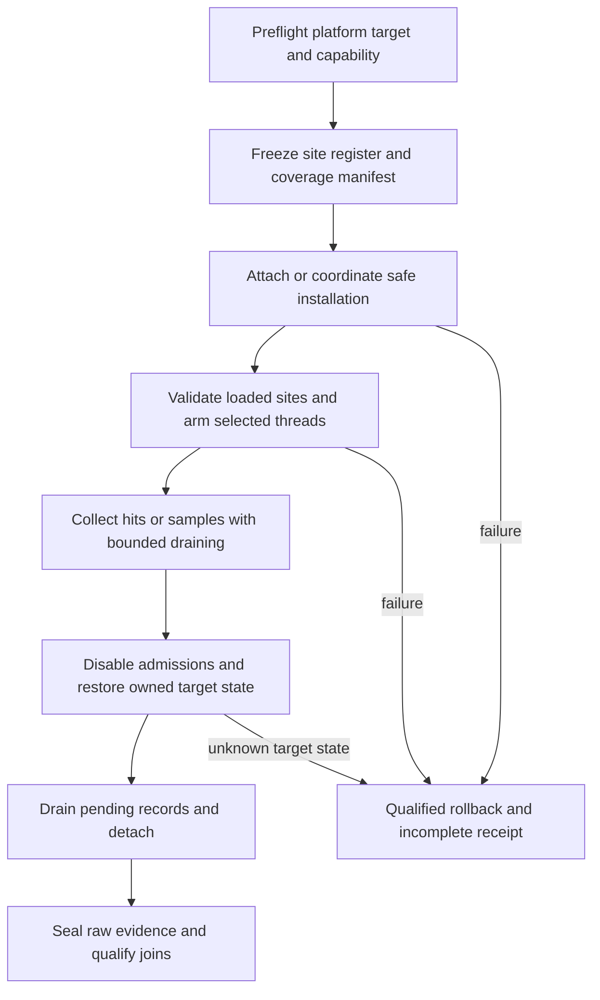

# External Address and Register Probe Contract

Implements R-HARN-TRACE-11.1–11.8 in [requirements](requirements.md), extending
[target instrumentation](spec.md#7-rea-and-target-instrumentation). This is a
collector contract; implementation status belongs to [gap](gap.md). It does
not add a mandatory dependency to the engine-integrated Perfetto SDK.

## Ownership and Platform Selection

The `probe` domain owns capability checks, target attachment, instrumentation,
raw capture and teardown. `join` validates external schemas, resolves identities
and clocks, and produces Perfetto-compatible normalized observations. `gate`
qualifies the selected claim. REA supplies static address/ABI evidence; the
engine owns its existing work identities and does not acquire debugger control.

| Mechanism | Observation | Applicable environment and limits |
|---|---|---|
| Linux `ptrace` | Debugger stops, registers, memory and controlled execution. | Linux target; stop/resume perturbs execution and is not a low-cost timing authority. |
| `perf_event_open` | Configured PMU/software/tracepoint samples or hardware address events. | Linux kernel API; supported events, permissions and architecture must be probed. |
| `perf record` | A configured event stream in `perf.data`, optionally with sampled call chains. | Linux tool frontend; event/clock/unwinder configuration and loss are part of the evidence. |
| `trishume/perftrace` | Hardware execution-breakpoint hits with time, IP, TID and selected registers. | Inspected Linux/x86 prototype; reference for targeted probes, not an admitted collector. |
| macOS debugger/Mach adapter | Stops and native register observations supported by the selected debugger/API. | Separate adapter; Darwin `ptrace` is not Linux perf, and native ARM64 state is not automatically guest x86 state. |
| Wine/guest marker | Selected guest call/phase observations. | Requires the existing marker ABI, installation, activation and observer-cost contracts. |

Linux lanes are optional structural/reference environments. A Linux VM cannot
use its perf API to observe the host macOS Wine process as a Linux task. Running
the same app on Linux/Wine or under emulation changes the execution environment;
those timings cannot substitute for the accepted macOS runtime baseline.
The catalogue/runtime contract remains authoritative for application launches;
standalone adapter fixtures are separately labelled and do not qualify a game.

## Probe Manifest and Interpretation

The selected `target-probe` profile declares `address-hit`, `cpu-sample`,
`debugger-stop` or `guest-marker` as its observation method. These are schema
values, not implemented command-line flags. Unsupported requests fail capability
preflight; the harness must not replace a requested address probe with sampling.

| Field group | Required content |
|---|---|
| Target | Run/attempt, process creation identity, module hash/architecture, loaded base and generation; native/guest address space and RVA convention. |
| Site | Probe ID/type, resolved address, expected instruction/relocation context, before/after-instruction semantics and REA source references. |
| Register interpretation | Register set/version, widths, requested and valid masks, ABI/calling convention and the evidence for each interpreted argument. |
| Coverage | Selected threads/incarnations, new-thread/fork/exec policy, attachment/activation intervals and per-thread installation results. |
| Collection | Event attributes, clock selection, period/frequency, stack/unwinder mode, buffer limits, hardware slot budget and drain policy. |
| Control | Required privileges/capabilities, explicit debugger ownership, deadlines, original state and rollback/detach policy. |

Address resolution follows module load/unload generations. An ASLR change
requires revalidation; a static VA, file offset, RVA and translated code-cache
address must never be interchangeable. Record a raw register snapshot even when
its semantic interpretation is unknown. Register contents may be hidden inputs,
temporaries or pointers, not necessarily source-level arguments. Optional memory
reads need explicit bounds, readability and consistency status; this contract
does not authorize indiscriminate process-memory snapshots.

An execution hit is an instant observation. A sampled stack is a sample, with
unwind failure/truncation retained. Neither is a complete function invocation.
Only qualified matching endpoints with recursion/invocation identity may form
a scope. Pointer-valued arguments join to D3D9 objects only with lifetime-aware
bindings; equality to a nearby logged pointer or temporal overlap is insufficient.

## Collection and Teardown

Thread inventory and selection policy are explicit. An event opened for one
Linux TID is not proof of process-wide coverage. Inheritance, thread creation,
exec and module reload are handled under the selected API's semantics or
excluded from the claim. Limited hardware breakpoint slots require admission
before collection; silently rotating sites cannot establish complete hit counts.

Kernel ring buffers must be drained with correct publication barriers, absolute
head/tail accounting, wrap-safe record copies and size validation. Decode
sample layouts from the actual configured ABI/attributes. Retain loss, throttle,
partial-register and unsupported-record outcomes. End-of-process-only reading
is insufficient unless a bounded fixture proves the buffer cannot overflow.
Raw binary draining/persistence may run in the external collector during the
window; expensive symbolization, joins and text formatting run afterward.
Collector CPU/I/O and target suspension remain part of observer perturbation.

The collector records breakpoint/trap cost separately from any debugger-controlled
stop duration. No claim assumes hardware breakpoints are free. OFF, installed/
armed and active controls identify different perturbations; where a control is
unavailable, record the limitation instead of inferring zero cost.

Disable/detach must restore only owned breakpoint/debug state and preserve
signals/exceptions according to the qualified adapter. Existing debugger
ownership conflicts fail preflight. Collector crash, pending stop, thread exit,
target exit and partial attachment need explicit cleanup outcomes. A timeout
does not authorize blind continue, signal suppression or termination. A test
fixture may have an explicit owned-process termination policy recorded in its
manifest; this is not a default application policy.

## Perfetto Join

External artifacts remain separate raw inputs. The engine SDK receives no new
Linux/debugger dependency. After collection, the `join` adapter maps qualified
observations onto process/thread tracks and preserves original source timestamps,
clock mappings, sample periods, register-validity masks and event IDs. Capture
receipt time is not an address-hit timestamp.
If a debugger exposes only the time a stop was observed, retain that timestamp
as an observation-time bound; do not label it the original trap/execution time.

Use instant events for address hits/stops and the appropriate sample representation
for sampled stacks. Unsupported clock alignment keeps source-local evidence
separate; it does not invent a shared time axis. Semantic labels from REA are
annotations. A hit at a query-poll call site can link to an engine receipt only
with a validated object/invocation mapping. Sampling weights, stop durations
and hit counts must not become exclusive CPU or inferred FPS savings.

## Reference Implementation Boundary

The identified external project is
[trishume/perftrace](https://github.com/trishume/perftrace). The inspected
`perftrace.c` blob `edb4e0564b60bfafe3c2fa933da5801be62a0314` and
`perftrace.py` blob `d9af3853dcace79cea7b7e935b40ba0219f9b95a` show the
following design and admission gaps; these findings are scoped to those blobs:

- `StoppedChild` uses `PTRACE_TRACEME` and detach to coordinate startup.
  `breakpoint_create` then uses `PERF_TYPE_BREAKPOINT` / `HW_BREAKPOINT_X`;
  Python does not stop/resume the target for every hit.
- The selected register table is x86-specific. A single task is configured;
  complete existing/new-thread coverage is not established.
- `breakpoint_next` skips non-sample records without loss reporting and uses
  a linear comparison of modulo ring addresses without complete wrap handling.
  Its fixed record layout and ordering assumptions require validation.
- The example waits for target exit before reading results; it supplies no
  proof against high-hit-rate overflow or complete scoped timing.

This is architectural reference, not vendored code or an approved dependency.
An adapter must pin its actual revision, verify license/notices and satisfy the
contracts above. Fixing one parser defect does not qualify platform support,
thread coverage, state preservation or timing overhead. The earlier retired
generic tool requirement remains retired; this named reference belongs only to
the external-probe contract.

## Verification and Admission

| Requirements | Required evidence |
|---|---|
| 11.1, 11.8 | Platform/capability matrix; Linux API rejection on macOS; actual supported-platform fixture; distinct VM/reference provenance. |
| 11.2, 11.5 | ASLR/module reuse, wrong hash/instruction/ABI, guest/native mismatch, partial-register and pointer-reuse counterexamples; known-argument fixture. |
| 11.3 | Existing/new-thread selection, failed slot allocation, thread exit/reuse, exec and partial-attachment coverage cases. |
| 11.4 | Wrapped/split/malformed ring records, overflow/lost/throttled events, record ABI variants, sampling weights and unwind failures. |
| 11.6 | Matched controls, recursion/tail/nonlocal-exit rejection, stop-vs-execution distinction and no observer-cost subtraction. |
| 11.7 | Attach/arm/disable/detach model/code evidence; pending signals, collector crash, timeout and preservation of unrelated debugger state. |
| 11.5, 11.8 | Pinned Perfetto consumer checks of instants/samples, IDs, clock uncertainty and rejection of unsupported causal joins. |

## External References

- [Linux ptrace](https://man7.org/linux/man-pages/man2/ptrace.2.html).
- [Linux perf_event_open](https://man7.org/linux/man-pages/man2/perf_event_open.2.html).
- [perf record](https://man7.org/linux/man-pages/man1/perf-record.1.html).
