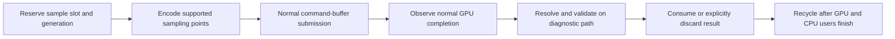

# Built-In GPU Timing Contract

Implements R-HARN-TRACE-10.1–10.7 in [requirements](requirements.md), extending
the [tracing architecture](spec.md). This is the intended contract, not a claim
of implemented integration. Status belongs to [gap](gap.md).

## Ownership and Measurement Levels

The unix collector owns capability selection, bounded sample storage, timing
metadata and validation. Queue/encoder code exposes actual work bindings and
normal completion facts without transferring scheduling or lifetime authority.
The Perfetto adapter consumes normalized POD results; the collector must not
depend on SDK types. Metal objects remain in unix/provider code.

| Level | Measurement source | Meaning and limits |
|---|---|---|
| Command buffer | `MTLCommandBuffer.GPUStartTime` / `GPUEndTime`, read after completion. | Driver-reported execution interval for that command buffer; not submit-to-callback latency or displayed frame time. |
| Encoder/pass-stage | Timestamp counter samples at supported encoder/pass stage boundaries. | Interval between the declared sampling points; not automatically whole-pass duration or exclusive stage cost. |
| Draw detail | Separately selected timestamp sampling where the device/API supports the required points. | Intrusive bounded diagnostic; absence of support remains unsupported. |

Command-buffer timing is the initial integration surface. Detailed sampling
requires its own capability and overhead qualification before admission. The
profile freezes requested levels, required/optional status, scope selectors,
per-window sample limits and resolve policy before arming. Preflight records
the actual device/OS, counter set and sampling-point support. Existing support
for timestamps at stage boundaries does not imply arbitrary per-draw support.

No pass splitting, extra production submission, query-result substitution or
scheduling policy change is permitted merely to make an unsupported scope
measurable. Any sampling barrier or diagnostic resolve command that is used
must be declared and costed, and must preserve production semantics. Hardware
performance-counter analysis remains a separate source from timestamp timing.

## Bounded Storage and Asynchronous Retirement

Reserve diagnostic capacity before encoding the sampled work. Both endpoints
and their metadata must have capacity; otherwise omit the scope and record
loss, rather than emit an apparently complete one-ended interval. The slot key
contains session, queue and allocation generations, not only an index or frame
number. Multiple queues, split/shared command buffers and out-of-order callback
delivery retain their actual ownership mappings.

Completion-critical callbacks may publish bounded readiness/identity records;
they must not call the SDK, allocate resolve buffers, format text or write files.
An allocating Metal resolve runs on a diagnostic path after the applicable GPU
work completes. A GPU resolve command, if used, participates in the same lifetime
proof: completion of sampling alone is insufficient while resolve still writes.
Expensive CPU decoding/export occurs outside the measurement corridor.

Capacity exhaustion drops new measurement work with explicit counts and affected
identities; it never blocks rendering or overwrites pending samples. Source-specific
unavailable/sentinel/error endpoints remain invalid until resolved or classified;
CPU callback time is never a replacement endpoint. Failed command buffers cannot
silently contribute successful normal-workload timing.

Closing a capture stops new sample admission but does not release outstanding
GPU resources. GPU-enabled sessions extend the engine session's draining condition
to include pending timing results and CPU readers. Finalization may await natural
completion on the diagnostic control path within its declared deadline; it must
not force a queue/device idle or change production wait predicates. On timeout,
mark the trace incomplete and quarantine storage until GPU/CPU access ends.
Explicit discard retires a result, not permission to free live backing storage.
Late callbacks and reset/device-failure paths must be checked against generations.

## Normalized Observation

| Field group | Required meaning |
|---|---|
| Identity | Run/session generation, device/queue incarnation, command-buffer ID, optional encoder/draw scope, slot generation. |
| Source | API/counter set, measurement level, start/end sampling points, stage/barrier/resolve policy. |
| Time | Reported endpoint values, units and conversion precision, clock-domain ID; retain raw device ticks when supplied. |
| Calibration | Mapping ID, observations, valid range, scale/offset and uncertainty, or explicit absence of a mapping. |
| Result | Validity/reason, completion status, selected/observed/lost counts and source-record references. |

Command-buffer API times and counter timestamps may have different units or
epochs. Apply [clock qualification](spec.md#5-clock-and-metric-qualification)
per source; do not infer equivalence from conversion to nanoseconds. A supported
paired CPU/GPU timestamp API may supply calibration observations, subject to
the same range/error checks. Callback timestamps cannot calibrate GPU completion
exactly because CPU scheduling and callback delivery add unknown delay.

Invalid calibration prevents placement on the shared CPU/GPU time axis. A
valid same-domain duration may still be reported separately with that limitation.
Nonmonotonic endpoints, source error sentinels and mappings outside their valid
range fail the dependent metric. Measured zero is distinct from unavailable
data, following the actual source's sentinel and resolution contract.

## Perfetto Interpretation

Use explicit GPU tracks keyed by device/queue and qualified work identity.
Scopes that can overlap use tracks or lanes that preserve overlap; they must
not be serialized into artificial non-overlapping work. CPU submit events link
to their actual command buffer, and encoders link through explicit membership.
CPU completion observation remains a separate event on its native thread.
Xcode replay intervals retain their separate run/capture identity.

Interval length is elapsed GPU time between named points. Summing overlapping
intervals does not yield device busy time; even an interval union requires a
declared coverage population and does not prove unobserved queues were idle.
Stage samples may overlap pipeline work and must not become exclusive shader
cost. Uncalibrated cross-source ordering, removable cost and display latency
must not be inferred. Timestamp timing alone provides no occupancy, bandwidth
or cache-miss attribution.

## Verification and Admission

| Requirements | Evidence |
|---|---|
| 10.1–10.2 | Capability fixtures, unsupported-level rejection, disabled-path checks, actual source/boundary labels and sampling-budget enforcement. |
| 10.3–10.4 | Model/code binding for slot reservation, GPU writes/resolve, CPU readers and reuse; stale callback, cancellation, reset, overflow and timeout counterexamples; no profiling-induced render waits. |
| 10.5–10.6 | Known-clock fixtures and invalid mapping/sentinel cases; split/shared-CB, multi-queue overlap and delayed-result tests; pinned Trace Processor checks of GPU tracks and flows. |
| 10.7 | Bounded actual-device command-buffer and supported detailed-sampling runs; paired OFF/ON CPU/GPU overhead and sample-loss reports; same-input image/query checks. |

Pure normalization uses deterministic tests. Concurrent sampling storage and
asynchronous retirement require R-VERIF-1.1–1.4 model/code evidence. Sampling
must preserve render output and production query/lifetime semantics; any change
to those behaviors additionally requires applicable R-VERIF-1.5–1.8 refinement
and GPU-oracle evidence. A visually plausible timeline cannot qualify storage
safety, timestamp accuracy or observer-OFF performance.
