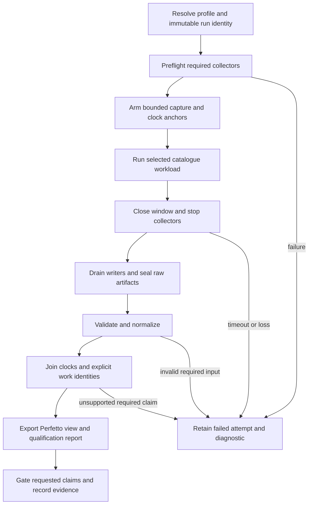
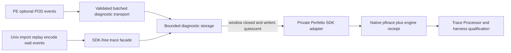
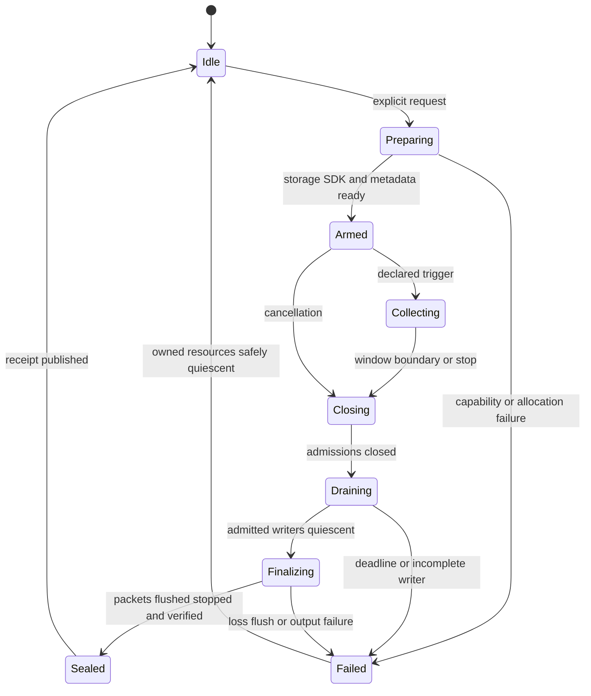

# Detailed Performance Tracing Architecture

Implements [requirements](requirements.md). This defines the target contract;
it does not claim that the integrated collector or exporters exist. Current
implementation and evidence are tracked in [gap](gap.md).

The integrated view connects application activity, D3D9 entry/recording,
bridge/import, replay, queue publication, encode, submission, GPU execution,
completion and waits. Perfetto is the selected engine tracing integration and
primary view/query surface. A private unix module owns the SDK and produces
native captures from bounded engine events. Existing native traces remain
authoritative inputs for compatibility and cross-checking. Built-in Metal timing
owns live GPU intervals; Xcode/Metal tools retain frame capture and detailed
hardware-counter acquisition. PE code remains
SDK-free. Build and runtime activation are opt-in, while integration itself is
a required deliverable under R-HARN-TRACE-9.1–9.9.

## 1. Ownership and Data Boundaries

### Perfetto overview and supplemental SQL observations

The tracing entry point defaults to the bounded `overview` profile. Ordinary
baseline experiments remain observer-off. The overview carries the engine
timeline and collector coverage; Command-buffer GPU timing is optional in overview; guest and expensive
detail sources are selected explicitly and missing domains are never presented as measured zero.

`scripts/tools/tracing_store.py` owns the cold-path companion analysis database.
It consumes validated normalized bundles and immutable supplemental inputs,
preserving raw records and provenance. Its Perfetto-style `track`, `slice`,
`counter`, `args` and `flow` surfaces are a local SQLite contract, not a replacement
for the pinned Trace Processor. Source clocks remain explicit on all rows;
unqualified sources are not placed on the engine timeline by assuming an offset.
Exact source IDs and unsigned values are retained as text when necessary.

The runner finalizes the database before sealing the artifact graph. The database
contains an acyclic snapshot of run/build/runtime/configuration and source
digests; it cannot hash itself or the final parent manifest. The final manifest
hashes the sealed database and `result.json` binds that manifest. Test producers
may use the same store API/CLI with their own outcome/provenance envelope.
Database integrity and successful publication do not qualify the observations.

Legacy CPU supply, wait and PE sample inputs use their existing strict adapters.
Their native CPU values, wait snapshots, frame windows, sample populations and
unknown clock/identity fields survive in SQL arguments and source records.
Other observations attach through a typed supplemental manifest: declared
collector/role, source digest and optional explicit engine event/work endpoints.
Opaque `.trace`, `.gputrace`, images and payloads stay external files. Raw engine
JSONL, external acquisition formats and crash breadcrumbs remain justified
simple-file acquisition/control artifacts; SQL is the structured analysis product.

Native slice annotations name the relative companion store and original source
record; SQL artifact links retain explicit event/work bindings. Structured logs
without timestamps use `diagnostic_row`/`diagnostic_value` rather than fake slices.
Archived conformance runs also expose `test_result` through the same schema.

Native numeric metrics use dedicated counter tracks with fixed metric names and
units; event owner IDs must never be repurposed as metric values. Queue depth
snapshots are a coarse initial consumer. Existing aggregate reports remain
available, and detailed observer migration requires semantic parity before
retiring any legacy gate or parser. The [shared acquisition contract](shared-acquisition.md) separates physical
sampling from consumer lifetimes. PE clock qualification remains independent
of sampler sharing and SQL export.

The [shared snapshot contract](shared-snapshots.md) extends this boundary to
query ledgers and acquired frame/append snapshots (R-HARN-TRACE-14.1–14.5).

Verification maps R-HARN-TRACE-12.1–12.6 to store round trips and failure fixtures,
runner manifest sealing, native counter consumer tests, and existing lifecycle
checks. Live observer cost is qualified separately under section 8.

This cross-domain profile uses the parent's eight stages and seven domains;
it does not introduce another launcher or redefine `domain` in the envelope.

| Owner | Responsibility |
|---|---|
| `runner` | Resolve profile/run identity; preflight and launch through `run_experiment.py`; record workload and collection outcomes separately. |
| `probe` | Bounded collector and target-probe lifecycles; raw exports, external clock markers, capability checks and teardown. |
| `reduce` | Validate/normalize dxmt9-owned CPU supply, wait, counter and PE sampling inputs; preserve their native qualification rules. |
| `join` | Normalize external xctrace/REA/tool inputs and join identities/clocks; produce the externally joined timeline. |
| `gate` | Check requested claims, coverage, overhead and comparison policies. |
| `audit` | Check retained manifests, digests and evidence citations. |
| `replay` | Retains fixed-input replay ownership; tracing can observe replay but cannot grant replay equivalence. |
| PE frontend | Windows-visible semantics and optional bounded guest/caller events. |
| Unix importer/queue/encoder | Their existing work identities and optional host observations; no trace-driven scheduling. |
| Unix tracing module | SDK dependency, session controller, diagnostic storage, native protobuf serialization and collection receipt; linked only into the unix provider and native test fixtures. |

A dxmt9-only timeline exporter belongs to `reduce`; an exporter consuming
external observations belongs to `join`, following the parent's origin rule.
Common schema/serialization helpers may be shared. REA supplies annotations,
not runtime timestamps or authority to inject code.

Diagnostic storage is separate from command packets, Slots, replay snapshots,
resource certificates and hot-path return values. IDs already owned by those
systems may be observed, but new diagnostic correlation state stays in a
bounded observer registry. PE records are drained in batches or to a local
diagnostic sink; exporters and external SDK integration execute outside hot
calls. No new bridge call per draw/state operation is permitted.

## 2. Collection Lifecycle and Profiles

Profile names below are contract names, not implemented CLI flags or new
`DXMT9_*` variables. Each profile is orthogonal to the existing `perf`/`debug`
experiment configuration. Actual resolved settings are recorded; contradictory
settings must fail preflight.

| Profile | Purpose and sources | Permitted claim |
|---|---|---|
| `baseline` | Existing workload timing; detailed tracing, sampling and hooks off. | Repeated workload-qualified timing with its stated timing source. |
| `timeline` | Engine-integrated native Perfetto capture of bounded CPU supply/wait events; explicitly selected PE and Metal observations. | Qualified scopes and explicit cross-layer relations within coverage. |
| `scheduler` | External scheduler trace, thread inventory and calibrated clock anchors. | Scheduler residency/enclosure for the qualified process/window. |
| `target-probe` | Frozen REA probe manifest and bounded application markers. | Executed target boundaries and their qualified relations/durations. |
| `gpu-detail` | Selected built-in GPU timing levels and/or xctrace/Xcode exports with source/capture identity. | GPU intervals or replay counters according to the actual source and supported sampling boundaries. |
| `emulated-structure` | Separately configured QEMU workload and instruction observations. | Structure of that emulated execution only. |

Sources may be combined only when collector coexistence and overhead are
qualified. Required collectors are fixed before launch; optional sources never
become substitutes after a required source fails. Preflight checks runtime and
artifact identity, tool capability, desktop/session needs, disk/memory budgets,
capture duration and finalization deadlines. Expensive postprocessing starts
after the measurement corridor. Streaming decoders are required for large
system-wide exports; filtering must still resolve references defined on other
processes' rows.

Every attempt writes failure metadata even when capture never starts. Window
closure precedes writer drain and seal; a timeout cannot seal a complete trace.
Cleanup targets only owned collector processes and restores installed probes
under their qualified teardown protocol. Failed raw artifacts are retained.

## 3. Bundle and Versioning

The run owns a tracing manifest under its existing experiment output directory.
Raw trace bundles live under `traces/<run-id>/` unless the existing collector
explicitly owns an experiment-output location. The manifest references those
locations by digest; it does not require moving existing evidence.

The proposed logical schema is `dxmt9-trace-bundle-v1`. Each derived artifact
also carries the [parent envelope](../spec.md#3-artifact-envelope): `schema`,
`producer`, `stage`, `domain`, `inputs`, `env_snapshot`, and `validity`.
Unknown major versions fail; supported optional extensions remain explicitly
unknown to older consumers. Legacy adapters must validate their original
schema and may not invent provenance missing from historical captures.

| Payload | Required content |
|---|---|
| Run manifest | Run/attempt identity; question/profile; app, staged binary and ABI identities; revision/dirty source digest; Wine, OS, CPU/GPU, tool versions; lane/resolution/settings; capture limits and resolved env; process outcomes. |
| Collector inventory | Name/version/configuration, required/optional status, activation evidence, start/stop, resource limits, loss/closure and output digests. |
| Identity tables | Process creation identity, guest/native thread mapping with validity interval, module hash/base/load generation, queue/device/object incarnations and work IDs. |
| Clock table | Clock ID/API/unit/resolution; calibration source samples, transform/domain/range and error bounds. |
| Events | Event ID, source artifact/record, track identity, event kind, timestamp/clock, applicable work IDs and typed attributes. |
| Relations | Source/target IDs, relation type, binding provenance and qualification. |
| Qualification | Per-source and per-claim verdicts, reason codes, loss, unmatched counts, coverage denominators, uncertainty and observer-control references. |
| Derived outputs | Perfetto view, machine-readable summary and concise report, each referencing exact inputs and converter version. |

IDs and raw integer timestamps must survive 64-bit precision. JSON uses decimal
strings for opaque IDs and integers that may exceed exact JSON-number consumer
precision. Exporter-local numeric track IDs use an explicit bijective mapping.
Absolute paths alone are not evidence identity. Unknown hashes, incomplete
module inventories or unavailable settings are recorded as unknown and block
claims that require them.

Raw artifacts are sealed before derived files are published. Publish manifests
atomically, reject destination collisions, and retain input digests on every
conversion. Never treat a matching old filename as an output of the current
attempt. Timing payload meanings in existing `result.json` remain unchanged.

## 4. Event and Relation Model

| Event family | Examples and interpretation |
|---|---|
| Application | Selected marker, function/call-site scope, scene boundary; exact semantics supplied by probe manifest. |
| PE | D3D9 entry/exit, caller module/RVA, recording or bridge batch; guest CPU samples remain samples. |
| Replay | Import, raw-ready, replay begin/end, receipt-ledger binding. |
| Queue/encode | Publication, slot wait, encode begin/end, render-pass/encoder identity, CPU preparation scopes. |
| Submission | Commit, sub-CB/shared-CB membership, completion dequeue/observation, retirement. |
| Wait/present | Mutex acquisition, predicate wait/reacquisition, query/readback, present boundary and drawable acquisition. |
| External | Scheduler intervals, signposts, driver/GPU intervals and replay-counter annotations. |

Relations distinguish `contains`, `publishes`, `consumes`, `waits_for`,
`submitted_in`, `observed_complete`, `caller_context`, and `annotates`.
Only evidence-backed dependency relations become causal flow arrows.
An ordinary scope belongs to one thread; asynchronous work uses explicit
tracks/relations rather than a begin on one thread and an implicit end on
another. Recursion needs distinct scope instances. Shared work is displayed
once and linked to its contributors; parent sums cannot double-count it.

Example query attribution follows a receipt's captured ledger/raw prefix to
replay records, actual publications and their submissions. It must not attach
the wait to the nearest draw or assume every command in a published Slot came
from that raw. Unmatched or cross-window work remains visible as unknown.
The existing [identity-qualified wait contract](../../../backend/identity-qualified-wait-trace.md)
remains authoritative for receipt and completion semantics.

## 5. Clock and Metric Qualification

Use a declared monotonic host domain as the common axis only for sources with
a valid mapping. QPC, host clocks, xctrace-relative time and GPU timestamps
retain separate clock IDs until proven compatible. Thread CPU is an accumulated
counter, never an alternative timeline coordinate.

Calibration records bracketed observations or equivalent tool clock snapshots,
the transform `host_ns = scale * source_ticks + offset`, and its error interval.
Clock discontinuity, drift outside the declared bound, suspend/resume or capture
trimming splits the validity interval or invalidates alignment. A timestamp
outside the calibration range must not be silently extrapolated. A pure offset
requires evidence for equal rate. Events closer than the mapping uncertainty
must not acquire a fabricated cross-source order.

The opt-in PE batch uses [direct endpoint point brackets](pe-clock.md): each
original QPC read is enclosed by two native clock probes in the same session
and native thread. Its integer midpoint and conservative error apply only to
that exact tick, including the first and last chunk. Approximate affine
coefficients are retained as metadata; they do not authorize extrapolation or
replace the exact midpoint. Slow observations remain unqualified under the
frozen clock-error policy, and sampling overhead remains part of the observed
execution.

An external marker can qualify xctrace alignment without changing the target.
It must identify its own process and retain both clock anchors across the
selected window; target process/thread identity is established independently.
GPU mapping requires the actual driver/device timing source and its supported
clock relation. Xcode replay measurements remain in a separate capture/replay
identity even when encoder labels match an original run.

Reports separately label elapsed scope time, native thread CPU, scheduler
residency, PC population, GPU execution, and replay counters. Exclusive CPU
requires a complete, non-overlapping same-thread partition. Scheduler Unknown
or Interrupted cannot be discarded to manufacture exact running CPU; any
enclosure must state the state-set and uncertainty. A sampled guest context
may remain at a bridge PC while the native thread executes or waits elsewhere.

## 6. Engine-Integrated Perfetto

### 6.1 Build and SDK Ownership

The integration uses the upstream [Perfetto tracing SDK](https://perfetto.dev/docs/instrumentation/tracing-sdk)
with its in-process backend. The SDK is a pinned private Meson dependency of
the unix tracing module, not a dependency of either PE DLL or the public C ABI.
The implementation must record revision, source digest, license and notices
before admission. SDK symbol visibility and one-time registration belong to
this module; other Wine modules may carry independent SDK copies without
sharing our session or shutdown authority.

Meson must offer explicit opt-in selection, default disabled. An explicit
enabled request with missing dependencies or an unsupported target fails
configuration. SDK-disabled builds use an SDK-free no-op facade and have no
SDK initializer, worker thread or allocation. SDK-enabled/runtime-off builds
retain only the permitted disabled-path check and do not initialize a session.
No SDK initialization, synchronous stop or file I/O runs from a loader callback
or production queue lock. This spec defines configuration semantics, not
already-implemented CLI flags or runtime environment variables.

### 6.2 Capture Path

The initial implementation uses per-thread bounded event storage, allocated
before collection, and a bounded identity/track registry. A new thread must
register through a cold path or claim a preallocated slot under a qualified
bounded protocol; inability to register is observable coverage loss. Event
emission preserves integer timestamp, source order, session generation and
work bindings. No event owns a borrowed pointer or changes a production Slot,
command packet or lifetime certificate. Scope state must be diagnostic-owned
or register-sized, with no disabled-path payload construction.

The engine itself serializes the captured records through a private SDK data
source after collection closes. This is an in-process native capture product;
no external JSON converter is needed to obtain `.pftrace`. A custom packet
adapter emits explicit original timestamps, clock IDs and track descriptors
rather than ordinary emission-time macros on the serializer thread. SDK work
is intentionally deferred so allocation, interning and flush cannot perturb
individual critical sections. SDK service startup/idle overhead still belongs
in observer controls. Direct SDK calls from hot paths and continuous streaming
are outside this initial contract. The optional
[asynchronous drain extension](asynchronous-drain.md) defines bounded producer
handoff, worker ownership, streaming loss and the separate cost/lifecycle proof
required by R-HARN-TRACE-16.1–16.6. Deferred output remains the default.

Thread buffers stop accepting records at capacity; they do not overwrite old
events or stall the workload. Per-thread loss counts and an out-of-band session
failure latch survive event-buffer exhaustion. Record count, thread count,
metadata, SDK buffers and export memory all have declared limits. Serialization
must check that loss did not occur inside SDK buffers as well as engine buffers.
Resource exhaustion yields unqualified evidence, not a larger implicit budget.

### 6.3 Session Ordering

The control path fixes run/session generation, categories, window/trigger,
storage limits, destination and deadlines before `Armed`. Startup readiness is
acknowledged before the workload corridor begins. A concurrent second request
is rejected; a later request gets a fresh generation only after safe teardown.
Admission and writer quiescence need model/code evidence: a writer admitted
before closure may finish, but cannot append after its storage is sealed or
reused. A scope crossing the window boundary is labelled clipped; closure
must not synthesize a completion for it.

After quiescence, preserve raw engine records and metadata, serialize native
packets, request/acknowledge SDK flush, stop the SDK session, read the completed
trace and atomically publish artifacts plus the receipt. SDK-specific flush
ordering must be qualified against the pinned release. Trace packets carry
original observation times, never finalization times. Interrupted finalization
cannot produce a successful receipt. A cleanup deadline does not authorize
freeing storage or unloading callback code with live writers; retain it safely
until quiescence or process exit and disqualify the attempt. Process exit/crash
without a receipt is an incomplete capture even if partial bytes survive.

The receipt binds session generation, process identity, requested/resolved
categories, actual window, source counts/loss, clock/identity tables, SDK build
identity, output digest and stop/flush outcome. The runner consumes it separately
from workload exit status. Runtime failures disable or close diagnostic
admission and report trace failure without changing render results, waking
production waits or forcing a GPU/queue drain for tracing.

### 6.4 Initial Event Surface

Category labels below name the schema contract, not implemented SDK constants.
Selection is fixed before arming. The default timeline is coarse-grained;
per-draw events require `detail` and a separately budgeted window.

| Category | Events and track/flow ownership |
|---|---|
| `import` | Import begin/end on the actual native thread, validated raw identity. |
| `replay` | Raw-ready, replay begin/end and receipt-ledger binding, preserving incarnation. |
| `queue` | Publication and queue-space waits, actual queue owner/sequence and raw membership. |
| `encode` | Encode begin/end on the actual worker; sub-work joins only where identities are available. |
| `wait` | Query/resource wait and mutex acquire/reacquire, predicate/target identity; no lock-holder inference. |
| `submit` | Actual commit and explicit sequence-to-command-buffer membership, including split/shared buffers. |
| `completion` | Completion-worker dequeue, CPU observation and retirement, separate from GPU execution. |
| `detail` | Selected command/draw scopes; disabled in the initial coarse profile. |

Producer threads own their tracks even though one adapter later serializes the
packets. Track IDs derive from run/session plus process/thread incarnation;
work flow IDs include owner/generation and relation identity, not only sequence.
PE thread IDs and native TIDs require an explicit mapping rather than numerical
equality. No synthetic flow is emitted for an unresolved relation.

Existing CPU supply/wait hooks are the preferred observation sites. Reuse their
qualified schema/predicates through adapters without requiring simultaneous
legacy CSV/log emission. A dual-output fixture is an explicit diagnostic
control with its own cost; duplicate event streams are not the default. Initial
native-only capture declares missing PE/application scopes. Later PE batches
use the generated, ABI-matched bridge and retain original clocks/order; they
never serialize SDK objects or add a bridge call per D3D9 event.

Built-in Metal timing follows the [GPU timing contract](gpu-timing.md), with
command-buffer intervals and separately qualified encoder/pass-stage samples.
Scheduler observations remain external. SDK integration alone does not establish
GPU coverage, scheduler states or whole-game CPU attribution; joins still follow
sections 4–5. GPU-enabled sessions must also satisfy the timing collector's
asynchronous retirement conditions before finalization.

### 6.5 Native Consumer and Compatibility Export

Native protobuf is the engine output contract. The bundle retains raw engine
events as source evidence and treats `.pftrace` as their engine-produced
serialization. Offline conversion of legacy inputs to Chrome Trace Event JSON
remains available as a compatibility design and independent cross-check; it is
not a prerequisite or substitute for engine integration.

Both adapters preserve scope/instant/counter/flow meaning and declared units.
Epoch rebasing and rounding must be bounded and tested. CPU counter deltas are
not elapsed slices, and snapshots cannot reconstruct per-draw histories.
Pinned Trace Processor queries compare fixture counts, durations, process/thread
tracks, nested scopes, flow endpoints and 64-bit identities with the raw input.
Consumer parse/loss diagnostics are retained; a successful UI import alone
cannot qualify the capture. Batch order, delayed serialization and descriptor
or incremental-state loss need explicit negative cases.

### 6.6 Emulated Observation

QEMU is a separate execution environment for structural questions. Its mode
must identify whether instruction callbacks are available; TCG and hardware
acceleration are not interchangeable. This design does not claim a QEMU GPU
path equivalent to dxmt9's existing Metal path.

## 7. REA and Target Instrumentation

The [external address/register probe contract](external-probes.md) specifies
platform-qualified debugger, hardware-breakpoint and CPU-sampling adapters.
Linux perf sources are optional reference lanes; macOS/Wine adapters require
independent qualification. They produce external evidence consumed by `join`,
without adding debugger or Linux dependencies to the engine Perfetto module.

Follow the [REA evidence workflow](../../../../agents/rules/debug_rea.rules.md).
Probe discovery proceeds from existing samples/caller addresses to bounded
static investigation, then to selected runtime markers only where those sources
cannot answer the question. REA does not itself provide a runtime hook backend.

The probe manifest freezes module SHA-256/architecture, image/RVA conventions,
expected instructions and relocation masks, ABI and live machine-state
requirements, probe semantics, threading/reentrancy assumptions, window/capacity,
installer version and rollback protocol. ASLR resolution uses the loaded module
base and load generation. Mismatch rejects installation before side effects;
partial installation rolls back or terminates the owned diagnostic attempt
without resuming partially patched execution.

Preserve original executable files; reversible in-memory patching requires
qualified safe points and instruction-cache publication. Synthetic ABI tests
precede game installation, and activation/hit evidence precedes timing claims.
Caller-PC-only collection must label immediate return addresses accurately:
wrappers, tail calls and unresolved modules cannot become inferred full stacks.
Before-call/continuation markers define coarse phases including inter-call work,
not exact callee self time. Supported exception/tail/recursion behavior is
explicit; missing exits are failures rather than synthetic end timestamps.

Controls distinguish unmodified code, installed inert markers and active
collection. Their differences expose installation and logging costs but do not
justify subtracting overhead from a live trace to manufacture baseline timing.

## 8. Failure, Gates and Verification

Each required claim is `qualified`, `unqualified`, or `unsupported`, with source
and reason references. Artifact validity is separate from claim qualification.
An explicitly requested complete-attribution export requires a nonempty selected
window, complete required endpoints, zero relevant loss/overflow, valid clock
coverage and unambiguous required relations. Diagnostic subset claims may use
only independently proven complete subsets and must name their denominator;
unknown loss locations disqualify every potentially affected interval.

Coverage thresholds and maximum clock error are profile inputs frozen before
collection. A required coverage ratio has an explicit population and numerator;
zero denominator fails. Ambiguous identity joins are rejected even when a
percentage threshold would otherwise pass. Legacy join gates are preserved,
including any stronger threshold required by their owner.

| Failure | Behavior |
|---|---|
| Required tool unavailable or unsupported architecture | Fail preflight; retain capability report. |
| Optional source unavailable | Record absence; reject dependent claims. |
| Overflow, missing closure, truncation or outstanding writers | Retain raw input; refuse complete attribution. |
| Hash, schema, identity or required clock mismatch | Reject the join/export claim; no nearest-match fallback. |
| Hook activation/rollback failure | Fail diagnostic attempt under the installer's safe teardown protocol. |
| Viewer conversion fails | Retain normalized inputs; report export failure independently of workload status. |
| Observer budget exceeded | Keep diagnostic evidence; reject low-perturbation/performance-transfer claims. |

Acceptance evidence is required in this dependency order: validated source
schemas and identities before joins; qualified clocks before aligned durations;
loss/coverage gates before complete-attribution claims; observer controls before
performance transfer. These are durable acceptance dependencies, not a session
implementation plan.

| Requirements | Required evidence |
|---|---|
| 1.1–1.3, 5.1 | Dry-run resolution, required/optional failures, retry collision and atomic-seal fixtures; unchanged legacy result consumers. |
| 2.1–2.3 | PID/TID/address reuse, multiple queues, shared/sub-CB, missing/duplicate binding, recursion and async-scope fixtures. |
| 3.1–3.4 | Known offset/rate/error fixtures; drift/discontinuity/clipping rejection; mixed CPU/wall/GPU negative cases; missing scheduler/sample coverage. |
| 4.1–4.3 | Disabled code-path/disassembly checks, allocation/bridge budgets, bounded-storage exhaustion and publication/drain model-to-code checks. |
| 5.2–5.3 | Pinned Perfetto consumer round trip; 64-bit ID precision, rounding, nonempty window, corrupt input and coverage counterexamples. |
| 6.1–6.4 | Static-to-loaded address fixture; wrong hash/bytes/ABI rejection; machine-state preservation mutants; install/rollback and actual-hit controls. |
| 7.3 | Pinned emulator/capability matrix, unsupported-mode rejection and explicit emulation provenance. |
| 8.1–8.3 | Matched observer controls, repeated workload-qualified timing, correctness checks and bounded Wine/Metal integration evidence. |
| 9.1–9.3 | SDK-disabled/enabled build and symbol/dependency checks; no PE SDK linkage; disabled-callsite disassembly; allocation/lock/bridge budgets and original-time deferred-serialization fixture. |
| 9.4, 9.7 | Session model/code checks for start/stop races, late writers, generation reuse, concurrent requests, overflow, cancellation, missing receipts and finalization deadlines. |
| 9.5–9.6 | Coarse-event coverage, legacy/native parity fixture, split/shared submissions, absent PE coverage and malformed/reordered PE batch counterexamples. |
| 9.8–9.9 | Pinned native Trace Processor queries and loss rejection; native host plus Rosetta unix provider with x86/x64 PE runs; SDK-off/runtime-off/active cost controls and independent-SDK coexistence. |
| 10.1–10.7 | [GPU timing verification](gpu-timing.md#verification-and-admission): capability, sample lifetime, clock/identity, native consumer, Metal correctness and observer-cost evidence. |
| 11.1–11.8 | [External probe verification](external-probes.md#verification-and-admission): platform, address/ABI, thread coverage, ring loss, debugger lifecycle, overhead and qualified Perfetto joins. |

These fixtures are required evidence categories, not claims that named test
targets already exist. Offline normalization is a pure transform and does not
change rendering. Concurrent observer lifecycles require R-VERIF-1.1–1.4
model/code evidence. If instrumentation changes production queue/lifetime/query
behavior, it has exceeded this observation-only design and must satisfy the
owning rendering refinement contracts before integration.

All remaining acquired diagnostic families follow [shared diagnostic consumers](remaining-consumers.md), R-HARN-TRACE-15.1–15.6.
