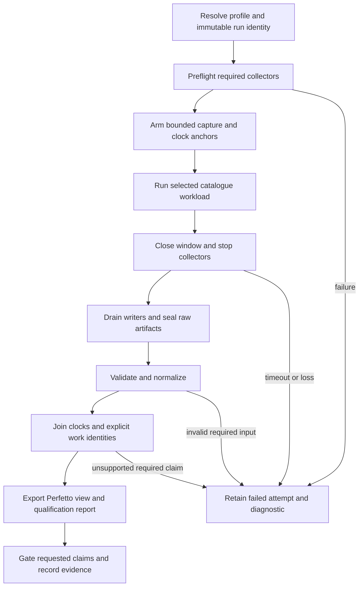

# Detailed Performance Tracing Architecture

Implements [requirements](requirements.md). This defines the target contract;
it does not claim that the integrated collector or exporters exist. Current
implementation and evidence are tracked in [gap](gap.md).

The integrated view connects application activity, D3D9 entry/recording,
bridge/import, replay, queue publication, encode, submission, GPU execution,
completion and waits. Perfetto is the primary view/query surface. Existing
native traces remain authoritative inputs; Xcode/Metal tools retain ownership
of GPU capture and counter acquisition. Tool adapters share evidence contracts
without requiring one instrumentation SDK throughout PE and unix code.

## 1. Ownership and Data Boundaries

This cross-domain profile uses the parent's eight stages and seven domains;
it does not introduce another launcher or redefine `domain` in the envelope.

| Owner | Responsibility |
|---|---|
| `runner` | Resolve profile/run identity; preflight and launch through `run_experiment.py`; record workload and collection outcomes separately. |
| `probe` | Bounded collector and target-probe lifecycles; raw exports, external clock markers, capability checks and teardown. |
| `reduce` | Validate/normalize dxmt9-owned CPU supply, wait, counter and PE sampling inputs; preserve their native qualification rules. |
| `join` | Normalize external xctrace/REA/tool inputs and join identities/clocks; produce the externally joined timeline. |
| `gate` | Check requested claims, coverage, overhead and comparison policies. |
| `audit` | Check retained manifests, digests and evidence citations. |
| `replay` | Retains fixed-input replay ownership; tracing can observe replay but cannot grant replay equivalence. |
| PE frontend | Windows-visible semantics and optional bounded guest/caller events. |
| Unix importer/queue/encoder | Their existing work identities and optional host observations; no trace-driven scheduling. |

A dxmt9-only timeline exporter belongs to `reduce`; an exporter consuming
external observations belongs to `join`, following the parent's origin rule.
Common schema/serialization helpers may be shared. REA supplies annotations,
not runtime timestamps or authority to inject code.

Diagnostic storage is separate from command packets, Slots, replay snapshots,
resource certificates and hot-path return values. IDs already owned by those
systems may be observed, but new diagnostic correlation state stays in a
bounded observer registry. PE records are drained in batches or to a local
diagnostic sink; exporters and external SDK integration execute outside hot
calls. No new bridge call per draw/state operation is permitted.

## 2. Collection Lifecycle and Profiles

Profile names below are contract names, not implemented CLI flags or new
`DXMT9_*` variables. Each profile is orthogonal to the existing `perf`/`debug`
experiment configuration. Actual resolved settings are recorded; contradictory
settings must fail preflight.

| Profile | Purpose and sources | Permitted claim |
|---|---|---|
| `baseline` | Existing workload timing; detailed tracing, sampling and hooks off. | Repeated workload-qualified timing with its stated timing source. |
| `timeline` | Bounded CPU supply/wait events; optional existing PE and Metal observations. | Qualified scopes and explicit cross-layer relations within coverage. |
| `scheduler` | External scheduler trace, thread inventory and calibrated clock anchors. | Scheduler residency/enclosure for the qualified process/window. |
| `target-probe` | Frozen REA probe manifest and bounded application markers. | Executed target boundaries and their qualified relations/durations. |
| `gpu-detail` | xctrace and/or Xcode capture/counter exports with capture identity. | GPU intervals or replay counters according to the actual source. |
| `emulated-structure` | Separately configured QEMU workload and instruction observations. | Structure of that emulated execution only. |

Sources may be combined only when collector coexistence and overhead are
qualified. Required collectors are fixed before launch; optional sources never
become substitutes after a required source fails. Preflight checks runtime and
artifact identity, tool capability, desktop/session needs, disk/memory budgets,
capture duration and finalization deadlines. Expensive postprocessing starts
after the measurement corridor. Streaming decoders are required for large
system-wide exports; filtering must still resolve references defined on other
processes' rows.

Every attempt writes failure metadata even when capture never starts. Window
closure precedes writer drain and seal; a timeout cannot seal a complete trace.
Cleanup targets only owned collector processes and restores installed probes
under their qualified teardown protocol. Failed raw artifacts are retained.

## 3. Bundle and Versioning

The run owns a tracing manifest under its existing experiment output directory.
Raw trace bundles live under `traces/<run-id>/` unless the existing collector
explicitly owns an experiment-output location. The manifest references those
locations by digest; it does not require moving existing evidence.

The proposed logical schema is `dxmt9-trace-bundle-v1`. Each derived artifact
also carries the [parent envelope](../spec.md#3-artifact-envelope): `schema`,
`producer`, `stage`, `domain`, `inputs`, `env_snapshot`, and `validity`.
Unknown major versions fail; supported optional extensions remain explicitly
unknown to older consumers. Legacy adapters must validate their original
schema and may not invent provenance missing from historical captures.

| Payload | Required content |
|---|---|
| Run manifest | Run/attempt identity; question/profile; app, staged binary and ABI identities; revision/dirty source digest; Wine, OS, CPU/GPU, tool versions; lane/resolution/settings; capture limits and resolved env; process outcomes. |
| Collector inventory | Name/version/configuration, required/optional status, activation evidence, start/stop, resource limits, loss/closure and output digests. |
| Identity tables | Process creation identity, guest/native thread mapping with validity interval, module hash/base/load generation, queue/device/object incarnations and work IDs. |
| Clock table | Clock ID/API/unit/resolution; calibration source samples, transform/domain/range and error bounds. |
| Events | Event ID, source artifact/record, track identity, event kind, timestamp/clock, applicable work IDs and typed attributes. |
| Relations | Source/target IDs, relation type, binding provenance and qualification. |
| Qualification | Per-source and per-claim verdicts, reason codes, loss, unmatched counts, coverage denominators, uncertainty and observer-control references. |
| Derived outputs | Perfetto view, machine-readable summary and concise report, each referencing exact inputs and converter version. |

IDs and raw integer timestamps must survive 64-bit precision. JSON uses decimal
strings for opaque IDs and integers that may exceed exact JSON-number consumer
precision. Exporter-local numeric track IDs use an explicit bijective mapping.
Absolute paths alone are not evidence identity. Unknown hashes, incomplete
module inventories or unavailable settings are recorded as unknown and block
claims that require them.

Raw artifacts are sealed before derived files are published. Publish manifests
atomically, reject destination collisions, and retain input digests on every
conversion. Never treat a matching old filename as an output of the current
attempt. Timing payload meanings in existing `result.json` remain unchanged.

## 4. Event and Relation Model

| Event family | Examples and interpretation |
|---|---|
| Application | Selected marker, function/call-site scope, scene boundary; exact semantics supplied by probe manifest. |
| PE | D3D9 entry/exit, caller module/RVA, recording or bridge batch; guest CPU samples remain samples. |
| Replay | Import, raw-ready, replay begin/end, receipt-ledger binding. |
| Queue/encode | Publication, slot wait, encode begin/end, render-pass/encoder identity, CPU preparation scopes. |
| Submission | Commit, sub-CB/shared-CB membership, completion dequeue/observation, retirement. |
| Wait/present | Mutex acquisition, predicate wait/reacquisition, query/readback, present boundary and drawable acquisition. |
| External | Scheduler intervals, signposts, driver/GPU intervals and replay-counter annotations. |

Relations distinguish `contains`, `publishes`, `consumes`, `waits_for`,
`submitted_in`, `observed_complete`, `caller_context`, and `annotates`.
Only evidence-backed dependency relations become causal flow arrows.
An ordinary scope belongs to one thread; asynchronous work uses explicit
tracks/relations rather than a begin on one thread and an implicit end on
another. Recursion needs distinct scope instances. Shared work is displayed
once and linked to its contributors; parent sums cannot double-count it.

Example query attribution follows a receipt's captured ledger/raw prefix to
replay records, actual publications and their submissions. It must not attach
the wait to the nearest draw or assume every command in a published Slot came
from that raw. Unmatched or cross-window work remains visible as unknown.
The existing [identity-qualified wait contract](../../../backend/identity-qualified-wait-trace.md)
remains authoritative for receipt and completion semantics.

## 5. Clock and Metric Qualification

Use a declared monotonic host domain as the common axis only for sources with
a valid mapping. QPC, host clocks, xctrace-relative time and GPU timestamps
retain separate clock IDs until proven compatible. Thread CPU is an accumulated
counter, never an alternative timeline coordinate.

Calibration records bracketed observations or equivalent tool clock snapshots,
the transform `host_ns = scale * source_ticks + offset`, and its error interval.
Clock discontinuity, drift outside the declared bound, suspend/resume or capture
trimming splits the validity interval or invalidates alignment. A timestamp
outside the calibration range must not be silently extrapolated. A pure offset
requires evidence for equal rate. Events closer than the mapping uncertainty
must not acquire a fabricated cross-source order.

An external marker can qualify xctrace alignment without changing the target.
It must identify its own process and retain both clock anchors across the
selected window; target process/thread identity is established independently.
GPU mapping requires the actual driver/device timing source and its supported
clock relation. Xcode replay measurements remain in a separate capture/replay
identity even when encoder labels match an original run.

Reports separately label elapsed scope time, native thread CPU, scheduler
residency, PC population, GPU execution, and replay counters. Exclusive CPU
requires a complete, non-overlapping same-thread partition. Scheduler Unknown
or Interrupted cannot be discarded to manufacture exact running CPU; any
enclosure must state the state-set and uncertainty. A sampled guest context
may remain at a bridge PC while the native thread executes or waits elsewhere.

## 6. Perfetto Export and Emulated Observation

The first export surface is offline conversion of validated existing events to
Chrome Trace Event JSON readable by Perfetto. Scope/instant/counter/flow records
use explicitly documented units; metadata and the bundle retain original
nanoseconds and identities. Epoch rebasing and rounding must be bounded and
tested. Do not encode CPU counter deltas as elapsed slices or counter snapshots
as reconstructed per-draw histories.

Native Perfetto protobuf is a separate adapter for stronger clock/track support
and larger captures. SDK-based collection is optional and requires the same
observer-cost gate. Viewer rendering or successful import is not a validity
test: automated consumer checks must compare event counts, durations, IDs,
hierarchy and relations against the normalized fixture using a pinned consumer
version. The report must expose losses and unsupported metrics even if the
viewer cannot render their full semantics.

QEMU is a separate execution environment for structural questions. Its mode
must identify whether instruction callbacks are available; TCG and hardware
acceleration are not interchangeable. This design does not claim a QEMU GPU
path equivalent to dxmt9's existing Metal path.

## 7. REA and Target Instrumentation

Follow the [REA evidence workflow](../../../../agents/rules/rea.rules.md).
Probe discovery proceeds from existing samples/caller addresses to bounded
static investigation, then to selected runtime markers only where those sources
cannot answer the question. REA does not itself provide a runtime hook backend.

The probe manifest freezes module SHA-256/architecture, image/RVA conventions,
expected instructions and relocation masks, ABI and live machine-state
requirements, probe semantics, threading/reentrancy assumptions, window/capacity,
installer version and rollback protocol. ASLR resolution uses the loaded module
base and load generation. Mismatch rejects installation before side effects;
partial installation rolls back or terminates the owned diagnostic attempt
without resuming partially patched execution.

Preserve original executable files; reversible in-memory patching requires
qualified safe points and instruction-cache publication. Synthetic ABI tests
precede game installation, and activation/hit evidence precedes timing claims.
Caller-PC-only collection must label immediate return addresses accurately:
wrappers, tail calls and unresolved modules cannot become inferred full stacks.
Before-call/continuation markers define coarse phases including inter-call work,
not exact callee self time. Supported exception/tail/recursion behavior is
explicit; missing exits are failures rather than synthetic end timestamps.

Controls distinguish unmodified code, installed inert markers and active
collection. Their differences expose installation and logging costs but do not
justify subtracting overhead from a live trace to manufacture baseline timing.

## 8. Failure, Gates and Verification

Each required claim is `qualified`, `unqualified`, or `unsupported`, with source
and reason references. Artifact validity is separate from claim qualification.
An explicitly requested complete-attribution export requires a nonempty selected
window, complete required endpoints, zero relevant loss/overflow, valid clock
coverage and unambiguous required relations. Diagnostic subset claims may use
only independently proven complete subsets and must name their denominator;
unknown loss locations disqualify every potentially affected interval.

Coverage thresholds and maximum clock error are profile inputs frozen before
collection. A required coverage ratio has an explicit population and numerator;
zero denominator fails. Ambiguous identity joins are rejected even when a
percentage threshold would otherwise pass. Legacy join gates are preserved,
including any stronger threshold required by their owner.

| Failure | Behavior |
|---|---|
| Required tool unavailable or unsupported architecture | Fail preflight; retain capability report. |
| Optional source unavailable | Record absence; reject dependent claims. |
| Overflow, missing closure, truncation or outstanding writers | Retain raw input; refuse complete attribution. |
| Hash, schema, identity or required clock mismatch | Reject the join/export claim; no nearest-match fallback. |
| Hook activation/rollback failure | Fail diagnostic attempt under the installer's safe teardown protocol. |
| Viewer conversion fails | Retain normalized inputs; report export failure independently of workload status. |
| Observer budget exceeded | Keep diagnostic evidence; reject low-perturbation/performance-transfer claims. |

Acceptance evidence is required in this dependency order: validated source
schemas and identities before joins; qualified clocks before aligned durations;
loss/coverage gates before complete-attribution claims; observer controls before
performance transfer. These are durable acceptance dependencies, not a session
implementation plan.

| Requirements | Required evidence |
|---|---|
| 1.1–1.3, 5.1 | Dry-run resolution, required/optional failures, retry collision and atomic-seal fixtures; unchanged legacy result consumers. |
| 2.1–2.3 | PID/TID/address reuse, multiple queues, shared/sub-CB, missing/duplicate binding, recursion and async-scope fixtures. |
| 3.1–3.4 | Known offset/rate/error fixtures; drift/discontinuity/clipping rejection; mixed CPU/wall/GPU negative cases; missing scheduler/sample coverage. |
| 4.1–4.3 | Disabled code-path/disassembly checks, allocation/bridge budgets, bounded-storage exhaustion and publication/drain model-to-code checks. |
| 5.2–5.3 | Pinned Perfetto consumer round trip; 64-bit ID precision, rounding, nonempty window, corrupt input and coverage counterexamples. |
| 6.1–6.4 | Static-to-loaded address fixture; wrong hash/bytes/ABI rejection; machine-state preservation mutants; install/rollback and actual-hit controls. |
| 7.3 | Pinned emulator/capability matrix, unsupported-mode rejection and explicit emulation provenance. |
| 8.1–8.3 | Matched observer controls, repeated workload-qualified timing, correctness checks and bounded Wine/Metal integration evidence. |

These fixtures are required evidence categories, not claims that named test
targets already exist. Offline normalization is a pure transform and does not
change rendering. Concurrent observer lifecycles require R-VERIF-1.1–1.4
model/code evidence. If instrumentation changes production queue/lifetime/query
behavior, it has exceeded this observation-only design and must satisfy the
owning rendering refinement contracts before integration.
