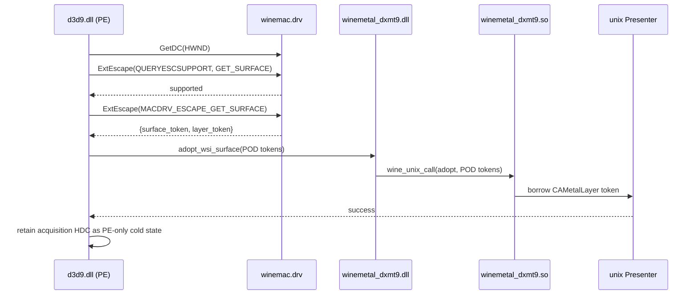
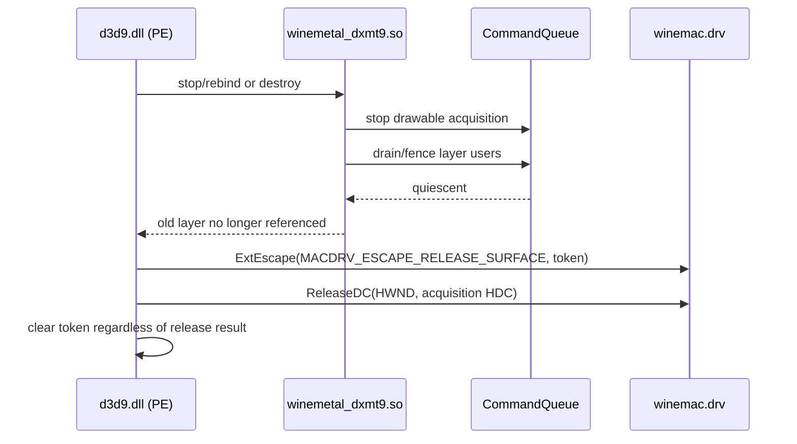

# winemetal Spec — Wine Metal Surface Bridge

## 1. Ownership

| Owner | Responsibility |
|---|---|
| PE D3D9 WSI control path | Own `HWND`/HDC operations, probe `ExtEscape`, retain opaque Wine surface token, issue exactly-once release |
| PE/unix bridge | Validate the fixed-width bootstrap payload and marshal opaque scalar tokens; never dereference them |
| unix presenter | Use the protocol-qualified layer, configure drawable properties, stop acquisition and quiesce GPU work before release |
| `winemac.drv` (ExtEscape) | Create and retain the client surface, own the layer, define the escape protocol |
| unix WineHQ adapter (owned-layer) | Own the attached Cocoa view/layer and generation-qualified host association; leave the Wine host window/event loop owned by Wine |
| deployment manifest | Declare the expected Wine protocol and record the exact runtime build |

The control-plane bootstrap is deliberately separate from pointer-free
`CommandChunk` traffic. PE code never calls Objective-C or Metal. Unix code
never calls GDI or owns the Wine client surface. Sections 2–3 describe the
borrowed ExtEscape path; section 8 defines the distinct owned-layer lifetime.

## 2. Acquisition Flow

The compatibility header owns the escape values and payload layout. PE passes
an exact two-`uint64_t` output buffer and accepts only a positive escape result
with nonzero surface and layer tokens. `QUERYESCSUPPORT` is mandatory because
Heroic/Gcenx packages can carry new DXMT DLLs beside an older unmodified Wine
runtime.

## 3. Lifetime and Rebind

The Wine surface token pins the borrowed layer. The PE swap chain keeps the
surface token; the unix presenter keeps only a borrowed layer wrapper.

For reset/rebind, PE acquires the candidate first. Unix adopts it atomically;
only a successful adoption permits release of the old token. This keeps reset
rollback possible and prevents a temporary null layer from escaping to present.

The retained HDC is a move-only PE capability separate from the portable token
state. Moving a device or swap-chain binding transfers both together; neither
the HDC nor its capability appears in `D9CWsiSurfaceBinding` or recorded replay.
A partial state that still owns the HDC balances `ReleaseDC` once even when no
surface token remains. A live token without the HDC remains an explicit
unfulfilled obligation and is not cleared.

### 3.1 Queue and registry lock order

The WSI gate follows one lock order. Candidate/final quiescence acquires the
queue mutex before the WSI mutex; Present admission holds only the WSI mutex,
increments its active-user count, then releases it before any queue or registry
operation. Quiescence releases the queue mutex while waiting for active WSI
users, reacquires it for the completion fence, and touches the presenter
registry only after that fence while the gate remains armed. The completion
thread uses the queue lifecycle mutex path and never acquires the WSI or
registry mutex. Final teardown arms the gate before waiting on an active arena;
if the queue is terminal, it joins encode/finish/completion workers before
registry invalidation and Presenter destruction. `endWsiQuiescence()` clears
the gate and notifies both blocked Presents and arena-admission waiters.

## 4. Legacy Fallback

If the escape query is unsupported, the unix provider may try the legacy
`macdrv_functions` path only when the active Wine manifest pins the exact build
as `legacy-macdrv-symbols:<runtime-id>`. Direct `dlsym` is not a generic
fallback for Wine 11.x: `RTLD_LOCAL`, private struct churn, and the absence of a
persistent client view are independent blockers.

The legacy flow remains for exact Wine manifest entries already qualified as
`legacy-macdrv-symbols:<runtime-id>`. Wine distribution names identify evidence
fixtures; they do not name or define the fallback. The old visibility patch is
archival compatibility material, not the forward deployment strategy.

## 5. Failure Behavior

| Failure | Result |
|---|---|
| `GetDC` fails | creation/rebind fails; no escape is issued |
| Escape unsupported and no exact-qualified fallback | `D3DERR_NOTAVAILABLE` |
| Malformed or zero-token response | protocol error; release any valid returned surface defensively, then fail |
| Unix adoption fails | release candidate surface; preserve old binding where reset rules allow |
| Release fails | log once, clear PE token, never retry or double-release |

A windowed device that requested presentation must not succeed with an
unattached layer. Offscreen-only operation, if added later, requires an explicit
D3D9-facing contract rather than an implicit black-window fallback.

## 6. Compatibility and Rollout

The rollout has three independently versioned parts:

1. The selected Wine/deploy lane must provide the required unixlib-loader
   capability from `R-DEPLOY-3.11`.
2. Wine must ship the accepted `MACDRV_ESCAPE_*_SURFACE` implementation, or be
   an exact runtime qualified for the legacy symbol or WineHQ owned-layer path.
3. dxmt9 must ship the matching PE client and unix adoption path.

All applicable parts must be present. Loading the unix provider on stock Wine
does not qualify WSI, and finding a legacy macdrv symbol does not qualify an
app-local loader. Downstream Wine builds may carry the Wine change before
upstream release, but the manifest must identify the exact source revision and
patch.

## 7. Verification Mapping

| Evidence | Contract |
|---|---|
| `dxmt9-wsi-surface-protocol-spec` | payload width, fixed-`cbOutput` response validation, fail-closed selection, callback-counted 6791/DC discharge, partial-state DC balance, missing-capability preservation, exact legacy identity |
| `dxmt9-cpu-ready-arena-lease-spec` + `WsiPresenterReplacement.tla` | candidate registry failure preservation, gate wait/notify conservation, terminal stop wake, active-arena finalization, attempted/accepted/completed ordinal conservation/liveness, and fence-before-release safety |
| `dxmt9-run-experiment-wsi-acquisition` + `dxmt9-wine-resolve` | identity-qualified legacy resolution plus mocked-`Popen` proof that CLI/catalogue/environment unsupported or unknown selection is gated before spawn |
| PE x64 and WoW64 WSI smoke | Wine escape availability and bridge scalar widths |
| Reset/additional-swap-chain integration | ordering and per-`HWND` ownership |
| Negative stock-Wine run | clean unsupported failure, no black-window success |
| Loader-pass / WSI-fail composition run | successful provider handshake remains distinct from `layer_acquisition=unavailable` |
| DXMT coexistence smoke | distinct module identities and independent D3D9/D3D11 initialization |

Runtime evidence must record the Wine root hash, escape protocol, dxmt9 bridge
ABI hash, and loaded paths for `d3d9.dll`, `winemetal_dxmt9.dll`, and
`winemetal_dxmt9.so`.

The implementation surfaces are `d3d9_pe_wsi.cpp` for HDC/escape ownership,
`dxmt9c_swapchain_{adopt,teardown}_wsi_surface` for the cold POD bridge, and
`SwapChain::{adopt,teardown}WsiSurface` for candidate-first replacement and
unix quiescence acknowledgement.

## 8. Unpatched WineHQ Owned-Layer Adapter

R-WMB-19 adds `winehq-owned-layer:<runtime-id>` as an exact-qualified fallback
after unsupported ExtEscape. This is a dxmt9 adapter identifier, not a new
upstream Wine ABI. Selection chooses the one fallback declared by the resolved
manifest, never a scan of arbitrary Cocoa windows or a cascade after malformed
escape success. ExtEscape stays preferred and qualified legacy behavior stays
required. Implementation and qualification status live in [gap.md](gap.md).

The [WineMetalGL investigation](../../docs/research/winemetalgl.md) demonstrates
why owning an attached view can be useful, but supplies neither a stable HWND
mapping contract nor dxmt9 qualification. The adapter must establish a unique
HWND-generation-to-host association through an audited runtime-specific
mechanism. No title/geometry-only match or assumed private struct offset may
serve as identity. If such an association cannot be established on a build, that
build remains unsupported; the spec does not assume a public Wine API exists.

### Ownership and ordered attachment

PE validates the window and collects Win32 client geometry/identity; a versioned
cold POD request carries these values to the provider. A provider registry owns
the association, Cocoa view/layer, callback generation, and presenter binding.
PE receives an opaque handle, never an Objective-C pointer or invented Wine
surface token. No per-draw window query is introduced.

The lifecycle uses a reservation and generation check around main-thread work:

1. Reserve a candidate generation under the lifecycle gate and retain all
   callback inputs, then release lifecycle/queue/registry locks.
2. On the Cocoa main thread, verify the host association and prepare the owned
   view/layer and client-region placement without changing Wine event ownership.
3. Reacquire the lifecycle gate and validate the reservation. Publish only if
   the HWND and swap-chain generations still match; otherwise discard the
   candidate on the main thread. Any existing binding remains authoritative
   until adoption succeeds.
4. For replacement/destruction, stop new users and fence admitted presenter/GPU
   users before detaching and releasing the old owned view/layer on the main
   thread. Retire queued callbacks through their retained generation claims.
   Shared physical views retain logical claims until the final swap-chain
   claimant retires; teardown of one binding cannot detach another's view.

No synchronous main-thread dispatch occurs while holding a queue, registry, or
swap-chain lifecycle lock. Completion callbacks cannot wait for a lock held by
their caller. Identity loss invalidates future admission and follows the
existing D3D9 device-status/rebind behavior; it never retargets a reused HWND.
If teardown cannot prove quiescence, retain the binding and diagnose the fault.
Unlike borrowed ExtEscape state, owned-layer retirement issues no 6791 escape.

Geometry updates carry explicit coordinate space and backing scale, preserve
parent/child clipping and stacking, and keep hit testing and focus with Wine.
Minimized/occluded windows use the existing presenter policy. Unsupported window
classes or ambiguous mapping fail acquisition; they do not get an unrelated
overlay or a no-window success.

### Required evidence

| Evidence | Contracts and acceptance |
|---|---|
| Native protocol/selector extensions (planned) | R-WMB-19.1/19.2: exact identity, unsupported-query-only fallback, malformed-success terminal failure, stale/ambiguous HWND rejection |
| Callback/lifetime native seams and bounded refinement (planned) | R-WMB-19.3/19.5: main-thread lock ordering, reset/destroy races, stale callbacks, rollback, exactly-once detach after GPU retirement; extend existing presenter models with owned-layer transitions |
| x64/WoW64 Wine PE integration (planned) | R-WMB-19.4/19.6: client placement, child clipping, multiple windows, DPI/monitor move, input/focus, minimize/restore, in-flight reset/destruction and HWND reuse |
| Compatibility composition and regression (planned) | independent loader pass, unknown-runtime/ambiguous-window negatives, legacy and ExtEscape lanes, separate DXMT D3D11 initialization |

These additions are evidence requirements, not claims that the existing section
7 tests already cover owned-layer behavior. Record exact runtime/adapter/OS/GPU
provenance and observed acquisition; no general WineHQ support is inferred from
a single passing build.
